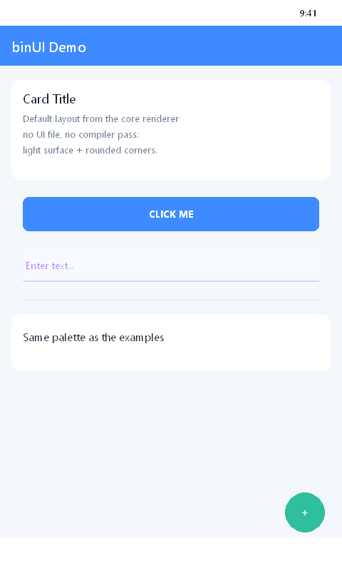
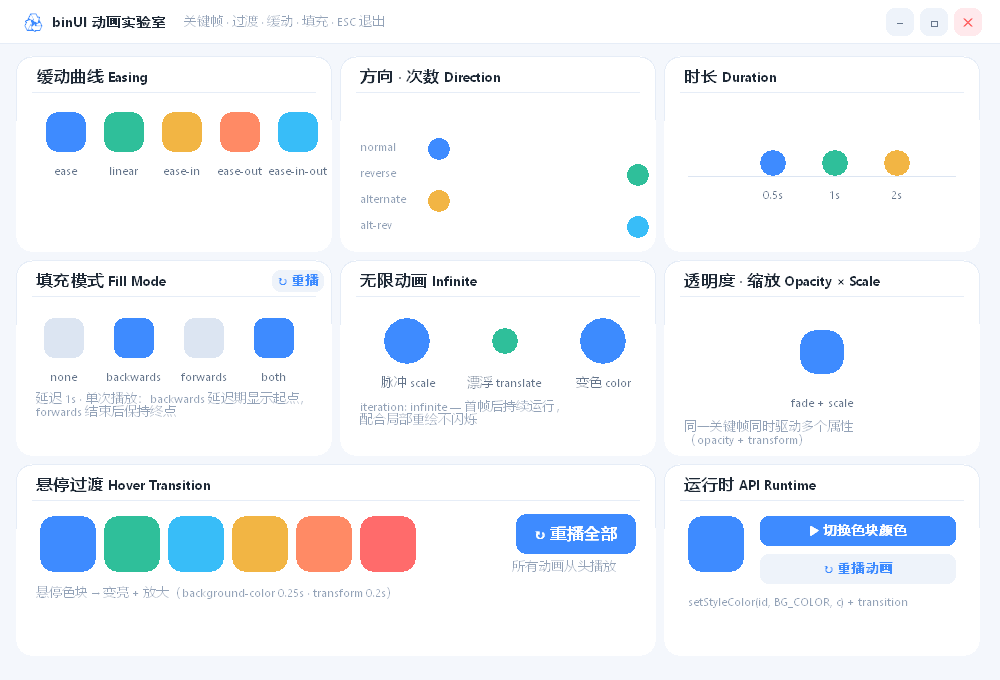
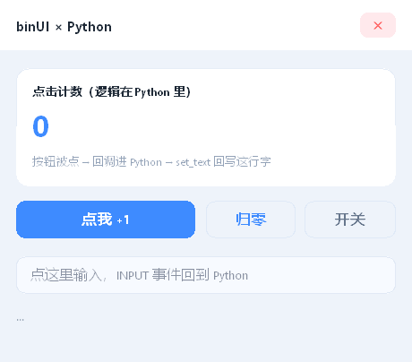
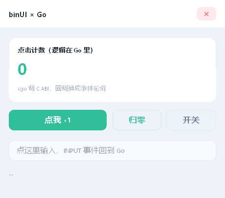
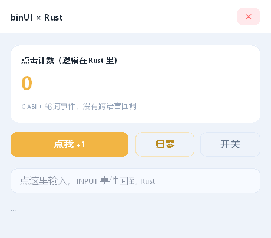

# binUI - 跨平台描述式 UI 核心

[](https://github.com/Hsiakey/binUI/actions/workflows/ci.yml)
[](LICENSE)
[](#构建)
[](include/binui_format.h)
[](#跨平台方向)

把 **UI 描述源码（XML / HTML5）编译为紧凑的二进制布局（binUI），再解析为节点树供任何渲染后端绘制**。纯 C++17，核心（编译/解析/命中测试/事件）无平台 API 依赖；字体渲染基于 FreeType + HarfBuzz（`third_party` 静态源码，跨平台一致）。

> 前身 `.xec`（含打包器 xecpack、加载器 xecrun 与动态加载层）已评估砍除——那层对多数场景是负资产；**保留并重构了真正有价值的部分：UI 编译、解析与渲染内核**。项目现名为 **binUI**，与二进制布局格式同名。

| 内置默认布局 | CSS 伪类 / 伪元素 | 组件化（`<use>`） |
|---|---|---|
|  |  |  |

> 三张图都是 `tools/offscreen_render` 离屏渲染出来的真实布局（GDI 后端），不是设计稿。

## 目录结构

```
include/            公共头：格式 / 编译器 / 渲染器 / 字体 / 图表 / 视频接口
                    应用侧 header-only 工具：binui_paths.h（路径解析）/ binui_hot_reload.h（热重载）
src/
  compiler/         XML、HTML5 → binUI（含 CSS 解析、级联、伪类与伪元素展开）
  renderer/         解析、节点状态、命中测试、事件、动画、滚动、文本编辑
  font/             FreeType + HarfBuzz 字体服务（灰度字形图集 + COLR emoji）
  backends/         binui_gl-gdi.*（OpenGL 3.3）/ binui_d3d11.*（D3D11）
  platform/         app_win32.*：Win32 窗口外壳 + GDI 绘制（演示与工具共用）
  binui_charts.cpp  高层图表 API 实现
  binui_video_*.cpp 视频模块（FFmpeg 实现 / 无依赖桩）
components/         **标准组件库**：titlebar / button / field / badge / toggle /
                    panel / dialogue / stat / avatar / divider / statusbar
                    （纯 HTML+CSS，<use src="…"> 编译期内联，见 components/README.md）
bindings/           **其他语言绑定**：Python(ctypes) / Go(cgo) / Rust(extern "C")，
                    统一对着 include/binui_c.h 的 C ABI（见 docs/bindings.md）
examples/           演示（每个子目录 = 一个 demo：main.cpp + main.html）
                      （6 组示例里 features 就是组件化三形态的活示例）
tests/              测试（轻量自写断言，8 个独立可执行文件）
tools/              调试工具：离屏渲染 / 窗口抓取 / 窗口枚举 / 示例 UI 检查（见 tools/README.md）
docs/               设计文档、图片、设计稿（见 docs/README.md；组件规范见 docs/components.md）
scripts/            fetch-deps.sh 等辅助脚本
third_party/        FreeType / HarfBuzz 源码（不入库，脚本拉取）
```

仓库约定、提交规范与"改格式必须做的三件事"见 [CONTRIBUTING.md](CONTRIBUTING.md)；版本与格式变更见 [CHANGELOG.md](CHANGELOG.md)；安全问题的报告渠道见 [SECURITY.md](SECURITY.md)。

## 组成

| 模块 | 说明 |
|------|------|
| `include/binui_format.h` | binUI 二进制布局格式定义 |
| `include/binui_compiler.h` | XML / HTML5 → binUI 编译器 |
| `include/binui_renderer.h` | binUI 解析、节点状态、命中测试、事件分发（纯 C++） |
| `include/binui_charts.h` | 高层图表 API：HTML 空容器 + 代码填数据，`tick()` 自动驱动动画 |
| `include/binui_font_renderer.h` | 跨平台字体服务：FreeType 光栅化（灰度 + COLR 彩色）+ HarfBuzz 整形 |
| `include/binui_link.h` | **布局链接器**：把组件布局合并进宿主（节点 id 重编号/坐标平移/各段迁移），编译期内联与运行期挂载共用 |
| `include/binui_asset.h` | 组件文件探测：二进制优先、源码更新则优先源码（同一份规则供编译器与加载器使用） |
| `include/binui_component.h` | 外挂组件加载（header-only）：`ex::MountAll()` 按布局里的组件引用段挂载 `.bum` |
| `include/binui_video.h` | 可选视频编解码模块接口：FFmpeg 解码 + WASAPI 音频（`BINUI_ENABLE_VIDEO`，默认 OFF 桩实现零依赖） |
| `src/platform/app_win32.*` | 演示用 Win32 窗口外壳 + GDI 绘制后端（可替换为其他平台后端） |
| `include/binui_paths.h` | 跨平台路径解析：exe 真实路径（`GetModuleFileName`/`/proc/self/exe`）+ UI 查找顺序 + 图片资源加载（`--ui` / `$BINUI_UI`） |
| `include/binui_hot_reload.h` | UI 热重载（`--watch`）：保存即重编译换树，保留窗口尺寸/滚动/焦点/输入内容 |
| `src/backends/binui_gl-gdi.h/.cpp` | GPU 绘制后端：OpenGL 3.3 + 字形图集 + 顶点四边形（无边框窗口） |
| `include/binui_c.h` | **C ABI**：定长 POD + 不透明句柄 + 轮询事件，给 Python/Go/Rust 等宿主语言的唯一入口（实现在 `src/binui_c.cpp`） |
| `bindings/` | 语言绑定：`python/`（ctypes）、`go/`（cgo）、`rust/`（手写 extern "C"） |
| `examples/features` | **功能**：伪类/扩展绘制/HTML 语义/组件化三形态/数据驱动 setText |
| `examples/animshow` | **动画**：缓动 / 方向 / 时长 / fill / infinite / 悬停过渡 / 运行时 API |
| `examples/fontshow` | **字体**：字号阶梯 / 字重 400–800 / 斜体 / 行高 / 文字装饰 / 中英混排与符号 |
| `examples/svgdemo` | **2D 渲染**：`<svg>` 声明式矢量（line/polyline/polygon/rect/circle）+ `<canvas>` 命令式绘制面 |
| `examples/cubedemo` | **3D 渲染**：应用自己算顶点与透视，只用 `fillLine` 画线框立方体（引擎不做 3D） |
| `examples/texturedemo` | **纹理**：`updateImageRaw` 运行期上传，同一张纹理多尺寸采样 |
| `components/` | **标准组件库**：标题栏 / 按钮 / 输入框 / 胶囊 / 开关 / 面板 / 对话框 / 指标 / 头像 / 分隔线 / 状态栏（见 [`components/README.md`](components/README.md)） |

> 所有示例统一使用一套**清新浅色主题**（页面底 `#F4F7FC` / 白卡片 + 1px 边框 / 主字 `#1F2A37` /
> 次字 `#66768C` / 主色 `#3E8BFF` / 薄荷 `#2FBF9A`）。这套令牌没有引擎级实现（`box-shadow`
> 这类合成效果仍不支持），就是各示例 `<style>` 里的一段约定 —— 改配色照抄 `examples/features`
> 开头的令牌注释即可。


## 第三方依赖

字体渲染使用 **FreeType**（字形解析/光栅化）与 **HarfBuzz**（文本整形），源码置于 `third_party/`。
体积约 130 MB，**不入库**，克隆后先拉一次：

```bash
sh scripts/fetch-deps.sh        # 或 make deps；GitHub 不通时：GITHUB_MIRROR=<镜像> sh scripts/fetch-deps.sh
```

脚本等价于：

```bash
git clone --depth 1 --branch VER-2-13-3 https://github.com/freetype/freetype.git  third_party/freetype
git clone --depth 1 --branch 10.2.0    https://github.com/harfbuzz/harfbuzz.git third_party/harfbuzz
```

各组件的许可证与分发注意事项见 [THIRD_PARTY_NOTICES.md](THIRD_PARTY_NOTICES.md)。

CMake 会直接 `add_subdirectory` 编译为静态库（MSVC/MinGW 均可）；Makefile 路径使用预编译静态库（见 `Makefile` 的 `GPU_LIBS`，MinGW 下用 CMake 或 meson 预构建 `third_party/freetype/build/libfreetype.a`、`third_party/harfbuzz/build-static/src/libharfbuzz.a`）。

## 绘制后端

渲染器只产出节点树（布局/状态/事件，纯 C++），像素由可替换的绘制后端负责：

| 后端 | 窗口 | 绘制 | 文本 | emoji |
|------|------|------|------|-------|
| GDI（`app_win32`） | 标准标题栏 | GDI 局部重绘 + 脏矩形 | `DrawTextW`（UTF-8→UTF-16） | 单色字形 |
| D3D11（`binui_d3d11`） | WS_POPUP 无边框 | GPU 四边形（图集/九宫格模板/离屏缓冲），VSync 按需呈现 | **FreeType 字形图集（灰度 8bit；≤16px 轻 hinting + gamma + 像素对齐）** | **彩色（FreeType COLR/CPAL 层合成）** |
| OpenGL（`binui_gl-gdi`） | WS_POPUP 无边框 | 同 D3D11 架构：GL 3.3 core + 顶点四边形/图集/九宫格/FBO，VSync（wglSwapIntervalEXT）；resize 拖拽期走 GDI `StretchDIBits` 呈现（规避 NVIDIA 驱动 SwapBuffers 崩溃） | 同 D3D11（共享 `binui_font_renderer`） | 同 D3D11 |

GPU 后端绘制原语（`fillRect`/`fillRounded`/`fillLine`/`strokeRounded`/`drawText`/`drawImage`）：纯色与圆角矩形为顶点四边形（九宫格模板），`fillLine` 用旋转四边形画**任意角度实心线段**（`x0,y0→x1,y1` + 线宽），文本走字形图集。GL 后端离屏帧缓冲为 **4× MSAA**（渲染到多采样渲染缓冲，`present()` 时 `glBlitFramebuffer` 解析到单采样离屏纹理），线条/圆角/圆的边缘全部抗锯齿；D3D 后端可直接用 `fillLine` 画线段。

D3D11 后端要点：
- 文字渲染委托 `binui_font_renderer`（FreeType + HarfBuzz），与 Windows GDI/DirectWrite 完全解耦——同一份字体服务可直接用于 Linux/macOS/OpenGL 后端。
- 文本：`FT_Get_Char_Index` + `FT_Load_Glyph` + `FT_Render_Glyph(FT_RENDER_MODE_NORMAL)` 把字形光栅化为 8bit alpha，白字黑底 → 预乘 alpha 进图集纹理，着色器顶点色染色。**渲染质量三件事**：
  1. **hinting**：`≤16px` 用 `FT_LOAD_TARGET_LIGHT`（只对齐竖笔，救小字清晰度），更大字号仍 `NO_HINTING`（保持跨平台一致）。可用 `BINUI_FONT_HINT=0|1|2` 强制全关/全 light/全 full 做对比，见 [hinting 对比](docs/font_hinting_modes.png)。
  2. **gamma 修正**：线性覆盖率直接当 alpha 会让小字偏细，光栅化时查 256 项 LUT 做 `pow(a/255, 1/1.3)`（小字号墨量 +10~13%，48px 只 +3.5%），效果见 [前后对比](docs/font_rendering_before_after.png)。
  3. **像素对齐**：字形位图按整数像素设计，`drawText` 里把起点 x 与基线 y 各 `round` 到整数，再靠整数 advance 累加 —— 整行字形都落在整数像素上，不被双线性过滤糊掉。
  
  advance 用 HarfBuzz/FreeType 的真实值（历史上曾 `+1`，导致文字比真实排版宽约 1px/字、组合符号被推离基字、换行宽度与实际绘制不符）。**ClearType 子像素抗锯齿有意不做**：它要求 1:1 不透明背景才能正确地按通道混合，而 binUI 大量使用透明分层窗口/离屏合成/等比缩放，这些场景下子像素会出彩色毛边（Windows 自己在分层窗口上也禁用 ClearType）。

- 彩色 emoji：HarfBuzz `hb_shape` 整簇（GSUB 合体/旗帜/肤色/VS16），FreeType 枚举 COLR 层（`FT_Get_Color_Glyph_Layer` + CPAL palette），逐层光栅化后按"底→顶"预乘 over 合成，上传独立彩色图集（格宽 4× 容纳 ZWJ 家庭序列）；簇检测覆盖 ZWJ 合体（👨👩👧👦）、肤色修饰（✊🏻）、变体选择符（❤️）、国旗双拼（🇨🇳）、键帽（1️⃣）。无 COLR 数据时自动降级单色（如 Segoe UI Emoji 的区域指示符为纯 outline）。
- `textWidth`/`drawText`/`drawTextWrapped` 均为 emoji 簇感知（整簇度量/绘制，宽度与光标定位一致）。
- 字体发现：`registerSystemFonts` 注册 Windows 系统字体（Segoe UI / Segoe UI Emoji / 微软雅黑），非 Windows 平台由调用方 `addFont` 注册（后续接 fontconfig）。

GPU 后端缩放处理（D3D11 / OpenGL 同构）：
- 手动拖边缩放时 `WM_SIZE` 只记录尺寸，合并为每帧应用一次（`applyPendingResize`），交换链/FBO 每帧至多重建一次，避免高频重建导致的花屏/卡顿。
- 拖拽循环（`startResize`）：窗口每帧实时跟随鼠标缩放（`SetWindowPos`），并每帧按新尺寸渲染离屏 + **`presentViaGdi` 呈现**（读回离屏像素 → `StretchDIBits` 到窗口 DC），拖拽中内容实时重绘、清晰跟手。**拖拽期间绝不 `SwapBuffers`**——实测 NVIDIA 驱动（nvoglv64 `DrvPresentBuffers`）在"窗口 resize + SwapBuffers"组合下稳定崩溃（角点圆周拖拽半圈内必崩，呈现路径跳到损坏的堆地址；vsync 开关/上下文 detach/节流呈现均无法规避），GDI 呈现完全绕开驱动 present 路径。松手时仍以 GDI 呈现一次最终清晰帧，surface 稳定后恢复正常 `SwapBuffers`（透明分层窗口本身走 `UpdateLayeredWindow`、不 SwapBuffers，不受影响）。
- D3D11 `ResizeBuffers` 失败时记录日志并自动重试一次。

透明窗口（`<app_window transparent="true">` 或画布 bg 带 alpha）：两 GPU 后端走 WS_EX_LAYERED 分层窗口，离屏 premultiplied 缓冲读回 → `UpdateLayeredWindow` 每像素合成到桌面；`resizable="false"` 时命中测试禁用拖边，`aspect` 在缩放循环内做等比约束。

## 快速开始

```bash
# 先拉第三方源码（只做一次）
sh scripts/fetch-deps.sh

# CMake
cmake -B build -DCMAKE_BUILD_TYPE=Release
cmake --build build -j

# 运行演示（6 组各一个，OpenGL 3.3 无边框窗口）
build/bin/features.exe         # 功能：伪类 / 扩展绘制 / HTML 语义 / 组件化三形态 / 数据驱动
build/bin/animshow.exe         # 动画：缓动 / 方向 / 时长 / fill / infinite / 悬停过渡 / 运行时 API
build/bin/fontshow.exe         # 字体：字号 / 字重 / 斜体 / 行高 / 文字装饰 / 中英混排与符号
build/bin/svgdemo.exe          # 2D 渲染：<svg> 声明式矢量 + <canvas> 命令式绘制面
build/bin/cubedemo.exe         # 3D 渲染：应用自己算顶点与透视，引擎只提供 fillLine
build/bin/texturedemo.exe      # 纹理：updateImageRaw 运行期上传，多尺寸采样

# 运行测试
ctest --test-dir build
```

或使用 Makefile：`make all && make test`（MinGW 下为 `mingw32-make SHELL=sh all`）。
调试工具（离屏渲染真实布局成 PNG、抓窗口、校验截图）用 `make tools` 构建，用法见 [tools/README.md](tools/README.md)。

> **Windows + Git bash 的坑**：用 Git 自带的 `sh.exe` 当 SHELL 时，Git 的 `mingw64/bin` 会排到 PATH 前面，测试程序于是加载 Git 带的旧 `libstdc++-6.dll`，表现为 `STATUS_ENTRYPOINT_NOT_FOUND (0xC0000139)` 或直接段错误。把目标工具链目录（如 `C:\ubin\mingw64\bin`）放到 PATH 最前再跑 `make test` 即可。

**UI 开发（热重载）**：所有 demo 支持 `--watch`，改 UI 保存后自动重编译并换树，不用重启进程：

```bash
build/bin/svgdemo.exe --watch                                 # 用 exe 同级的 UI
build/bin/svgdemo.exe --watch --ui examples/svgdemo/main.html  # 直接盯源码树
```

窗口尺寸/滚动位置/键盘焦点/输入框内容跨重载保留；编译失败保留旧界面。`--ui <path>` 显式指定 UI 文件，也可用 `$BINUI_UI`；默认查找顺序：`<exe>/<appName>/<file>` → `<exe>/<file>` → 已编译的 `.bui`（旧名 `.binui` 也认）→ 源码树 `examples/<appName>/`（规则见 [`docs/app_layout.md`](docs/app_layout.md) §3）。

## 使用流程

```cpp
#include "binui_compiler.h"
#include "binui_renderer.h"

binui::BinUIRenderer renderer;

// 1. 编译 UI 源码为 binUI 二进制布局（XML 或 HTML5 均可）
auto res = binui::CompileBinUIFileEx("main.html"); // Ex 变体额外返回图片资源路径
// 编译期警告（不支持的单位/函数值、认不出的颜色等）——同一份 UI 内去重，也已打到 stderr
for (const auto& w : res.warnings) std::fprintf(stderr, "[ui] %s\n", w.c_str());

// 2. 解析为节点树
renderer.loadLayout(res.layout.data(), res.layout.size());

// 2.5 加载图片资源（CompileResult::images 即 src 顺序，imageIndex 指向它）
std::unordered_map<std::string, std::vector<uint8_t>> resources;
for (const auto& p : res.images) resources[p] = ReadFile(p);
renderer.setImageOrder(res.images);
renderer.loadResources(resources);

// 3. 运行时更新
renderer.setText(4, "Hello World!");     // 改文本
renderer.setVisible(5, false);           // 显隐
renderer.setEventCallback([](const binui::Event& ev) { /* 点击/输入/尺寸事件 */ });

// 3.5 运行时创建/查找节点（配合 HTML 里的 id）
uint16_t chartBox = renderer.findNodeByName("barChart");       // id 属性 -> 节点
uint16_t bar = renderer.addNode(chartBox, binui::BINUI_LIST, 10, 20, 60, 120, 0xFF8B5CF6, 4, 0);
renderer.removeNode(bar);                                       // 隐藏（保留，可 setVisible 恢复）
renderer.restartAnimations();                                   // 重播所有动画

// 4. 渲染：任意后端遍历 renderer.getNodes() 绘制即可
//    （Win32 示例直接用 drawNodesGDI(hdc, renderer)）
```

## 在别的语言里用（C ABI）

引擎是 C++ 的，对外只开一扇门：`include/binui_c.h`（实现在 `src/binui_c.cpp`）。
它把整个曲面压成**定长 POD + 不透明句柄 + 轮询事件**三件套 —— 没有跨语言回调，
所以不需要操心线程亲和、GC 保活、重入。

```sh
mingw32-make SHELL=sh capi
# build-mingw/libbinui_c.a          静态库（C / C++ / Rust）
# build-mingw/bin/binui_c.dll       动态库（Python ctypes / Go cgo）
```

```python
import binui
layout = binui.compile_source(open("ui.html", encoding="utf-8").read())
with binui.App(layout) as app:
    app.open(title="Python 驱动")
    while app.pump():                       # 8ms 超时，空闲不烧 CPU
        while (ev := app.poll()) is not None:
            if ev.type == binui.CLICK:
                app.set_text(app.find("count"), "被点了")
```

已带三份绑定（Python `ctypes` / Go `cgo` / Rust 手写 `extern "C"`），都跑通并覆盖了
点击、文本输入、中文与 emoji 输入：

| 语言 | 目录 | 跑法 |
|---|---|---|
| Python | [`bindings/python/`](bindings/python/README.md) | `python bindings/python/demo.py` |
| Go | [`bindings/go/`](bindings/go/README.md) | `cd bindings/go && go run ./demo` |
| Rust | [`bindings/rust/`](bindings/rust/README.md) | `cd bindings/rust && cargo run --example demo` |

| Python 绑定 | Go 绑定 | Rust 绑定 |
|---|---|---|
|  |  |  |

设计约束、线程规则、ABI 布局自检、新增语言的步骤见
**[docs/bindings.md](docs/bindings.md)**；总表见 [bindings/README.md](bindings/README.md)。

**两种形态**：`binui_app_open` + `binui_pump`（binUI 自己当应用，无边框顶层窗）和
`binui_app_open_child` + `binui_render`（作为控件嵌进宿主窗口，宿主管消息循环/布局/DPI）。
后者是接 WPF / Qt / WinForms 的路径，宿主窗口记得带 `WS_CLIPCHILDREN`，否则
父窗口的 `WM_PAINT` 会把子窗口那块一起刷掉。活例子：
[`bindings/python/demo_child.py`](bindings/python/demo_child.py)。

> 目前只支持 Windows + OpenGL 3.3；核心库跨平台，外壳不是。子窗口模式下没有窗口级
> 透明（`WS_EX_LAYERED` 对子窗口无效），也不带标题栏拖动/边框缩放。

## UI 描述格式

两种源码格式，编译为统一的 binUI 二进制布局：

| 源码格式 | 说明 |
|----------|------|
| `.xml`   | 手写 XML，节点标签映射为节点类型（见 `tests/fixtures/vision.binui.xml`）；`.bui.xml` / `.bum.xml` 同样按 XML 解析 |
| `.html`  | HTML5 语法，支持流式布局与 `style` 绝对定位（见 `examples/animshow/main.html`） |
| `.bui` / `.bum` | 已编译好的 binUI 二进制（`loadLayout` 直接吃；`.bui` = 界面，`.bum` = 组件） |

HTML5 编译规则：
- 标签映射：`html/body`→根，`button`→按钮，`input[type=text]`→输入框，`input[type=button/submit/reset]`→按钮（未写 `value` 时用内置文案 Submit / Reset / Button），`img`→图片，其余（`div/section/header/footer/nav/` 等）→容器。
  **行内文本标签**（`h1~h6 p span label a b i em strong small u s strike del ins mark code kbd samp var abbr cite q dfn time sub sup li td th dt dd figcaption summary caption legend title`）一律编成 `BINUI_LABEL`；`<br>`→文本内硬换行（编译成 `'\n'`，并撑开未声明高度的节点），`<li>`→文本（父为 `<ul>` 自动加 `• `，父为 `<ol>` 自动加序号）。
  **没有行内格式化上下文**：行内元素各占一行（`<p>a <b>b</b></p>` 里的 `<b>` 会换行），同一行混排多种样式需要富文本段（未实现，编译期会警告一次）。
- 定位：支持显式 `x/y/w/h` 属性，或 `style` 中的 `left/top/width/height`；**子元素坐标相对父容器内容盒**（父位置 + padding），未指定坐标的元素在**父容器内**按文档流自上而下堆叠。
- 层级布局：每个容器有独立流光标，流式子元素排布在容器内部；容器高度不足时自动扩展到容纳其流式内容。
- 边距：`margin`（及 `margin-top/right/bottom/left`，支持 1~4 值简写）影响流式间距与左右内缩。
- 内边距：`padding`（及 `padding-top`）存入节点，绘制文本时内缩，并作为子元素的偏移基准。
- 百分比尺寸：`width/height/left/top` 支持 `N%`（相对父容器内容盒宽/高解析）；根 `width/height:100%` 即铺满窗口（编译期按默认窗口 1280x720 解析，运行时由 `setSize` 驱动）。编译产物（v3）追加缩放规格段，渲染器 `setSize(w,h)` 时对百分比/流式/flex/自动宽节点重排，滚动偏移按新视口钳制；静态布局仅同步根尺寸。
- **组件化（`.bui` / `.bum` / `.bum.xml`）**：一个界面 = 一个 `.bui`（组件全内联，运行期零依赖）；
  想拆开就拆成 `.bui` + 若干 `.bum`，二进制与源码可混放。三条路线：
  `<use src="x.bum.xml">` 源码内联（可传 `{{参数}}`）、`<use src="x.bum">` 二进制内联（链接器离线合并，
  同一套合并规则，不暴露源码）、`<use src="x.bum" external>` 运行期挂载（布局里只留占位节点 +
  组件引用段，`binui::ex::MountAll()` 挂上，换组件不用重编主 `.bui`）。加载优先级：**二进制优先，
  源码 mtime 更新时改用源码并告警**（改源码保存即热重载，不会“改了没反应”）。参数值按纯文本注入
  （不会变成标签），`{{名=默认值}}` 在单独编 `.bum` 时取默认值；组件内可再引用组件（深度上限 8）；
  组件内相对资源路径自动改写成宿主相对路径，图片清单随布局写出（v12 资源段）。
  **组件自带的 `<style>` 是全局的**（可被宿主主题化，也需类名前缀约定），参数化样式请写内联。
  完整契约见 [docs/components.md](docs/components.md)。- **长度单位**：`px`（可省略）与 `%` 之外，还支持 `em`（相对该元素 `font-size`）、`rem`（相对根字号，默认 14）、`vw`/`vh`（相对**编译期**视口；不随运行时 resize 重排，需跟随请用 `%`）。**不支持的单位**（`pt/cm/mm/in/ex/ch/vmin/vmax`）与**函数值**（`calc/min/max/clamp`）会**打编译警告并回退默认值**，不再静默当成 px（警告同时收集在 `CompileResult::warnings`）。
- 颜色：支持 CSS **命名色**（完整 147 色 + `transparent`）、`#RGB`/`#RRGGBB`、`#ARGB`/`#AARRGGBB`（**8 位按 binUI 约定的 AARRGGBB**，与 CSS 的 `#RRGGBBAA` 相反，首次使用会警告）、`rgb()/rgba()`（逗号或空格分隔、通道可写百分比、支持现代 `rgb(0 0 255 / 50%)`）、`hsl()/hsla()`。`!important` 会被剥离。无法识别的颜色**保留默认色并警告**（以前是静默变白/变透明）。
- 尺寸约束：`min-width/max-width/min-height/max-height`（值支持 `N` 像素与 `N%` 相对父内容盒；XML 下为同名属性）。min 撑开尺寸（自动宽/声明宽小于最小值时）、max 收缩（百分比/自动宽超过上限时）；flex 子项弹性分配后同样受约束钳制（钳制释放的空间不向兄弟项再分配）。编译期按初始窗口生效，运行时 `setSize` 重排按新视口重新解析。
- **等比 UI 缩放（`<app_window ui_scale="proportional">`）**：`setSize` 不再做流式/百分比/flex 重排，而是把整棵节点树的坐标/尺寸/字号/圆角按「新窗口 ÷ 设计尺寸」等比写回 `nodes_`——**固定像素布局也能整体跟手缩放**，且命中测试/滚动/绘制读同一份缩放后坐标、天然一致；字形按缩放后的字号重新光栅化（图集缓存，清晰不糊）。与 `window_resize="aspect"` 组合即"窗口仅等比例 + UI 等比缩放"。动态运行时节点（图表 API 的 `addNode`）不参与缩放，图表类应用不要启用此模式。
- 样式：支持 `style` 里的 `background/background-color/color/font-size/border-radius/border*/linear-gradient/font-weight/font-style/line-height/white-space/text-decoration/z-index/text-align/opacity`（颜色与长度写法见上面的「颜色」「长度单位」两条）。**v13 起底色与文字色分家**：`background*` 是底色、`color` 是文字色，且 `color` 沿元素树继承 —— 浅色主题终于可行（以前只有一个颜色字段，容器里写字就是"深色块 + 白字"）。`text-align: left|center|right` 用节点 flags 的两个空闲位编码（**不新增字段、不升格式版本**，旧布局两位为 0 = 左对齐）；`opacity` 在编译期折进节点颜色 alpha（**没有合成组**，子节点不跟着变淡；要整块淡出用 v7 动画的 opacity）。**层叠顺序**：`z-index`（XML 为 `z-index`/`z` 属性）数值越大越靠上；**绘制按树遍历**——父节点先于子节点（容器底色不会盖住自己的内容），同一父节点下按 `z-index` → 流式先于 absolute → DOM 顺序排；命中测试取这棵顺序的逆序（最上层优先）。**默认直角**：`border-radius` 为可选项，不写则元素为直角；写 `border-radius:N`（或 XML `radius="N"`）才按 N 像素圆角绘制（按钮/容器/图片占位均生效）。
- **扩展绘制段（v13：边框 / 渐变 / 字重 / 行高 / 文字装饰）**：这些属性只落在少数节点上，所以单独编成一段（`BinUIPaintNode`，v13 为 40 字节、v14 起 44 字节），不往定长的 `BinUINode` 里加字段，旧二进制语义不变。支持 `border`（简写 `<宽> solid <色>`）、`border-width` / `border-color`（1~4 值展开）、`border-top/right/bottom/left`（**四边各自宽度与颜色**，画在节点内侧、不参与布局；**圆角元素按圆弧逐行铺薄条**，不会出现"方框套圆角"的脏边）、`linear-gradient(...)`（`to bottom|top|left|right`、`135deg`，取首尾两色；对角按垂直近似；`radial-gradient` 不支持）、`font-weight`（`bold`/`600+` → FreeType 合成加粗，GDI/GL/D3D 三端都真加粗）、`line-height`（无单位倍数 / `%` / `px`）、`text-decoration`（`underline` / `line-through` / `overline`）。**`box-shadow`/`text-shadow` 仍不支持**：GDI 后备后端没有 alpha 合成，做了会三端不一致，宁可明说。
- **`<style>` 里的普通 CSS 规则参与级联**（不止动画）：支持 `tag` / `.class` / `#id` / `*`、**复合类**（`.btn.primary`）、**属性选择器**（`[type=text]`、`[href^=http]`、`[class~=x]`、`[lang|=zh]`）、**后代/子代/相邻兄弟/后续兄弟组合子**（`.card .title`、`.card > .title`、`h2 + p`、`h2 ~ p`）以及逗号选择器组。优先级与浏览器一致：**内联 `style` > `#id` > `.class`/属性/伪类 > `tag`**，同权重时后写的胜（`!important` 仍被忽略）。`display:none` 经 class 生效（整棵子树不生成节点）。**仍不支持**：`@media`（编译期不知道运行时尺寸，整块忽略并告警）、`@font-face` / `@import` / `<link rel=stylesheet>`（样式只能内联进 `<style>`）。
- **运行时伪类（v11）**：`:hover` / `:active` / `:focus` / `:checked` 编译成**状态样式段**，渲染器在指针/焦点/勾选变化时把作者声明的 `background*`（`LABEL` 另有 `color`/`text-color`）、`transform: scale()`、`border-radius`、`opacity` 作为目标值切过去——声明了 `transition` 的节点走现成的过渡通道，否则瞬时。优先级（同时命中时）：**`:active` > `:focus` > `:checked` > `:hover`**。`:hover`/`:active` 对**任何元素**生效（不只控件：命中测试会把声明了该状态的普通节点纳入）；`:focus` 同时覆盖键盘焦点与正在编辑的输入框；`:checked` **由外壳维护**（核心库没有勾选控件）——`renderer.setNodeChecked(id, on)` / `isNodeChecked(id)`，点击自己控件时调用即可。未写状态样式的按钮仍走旧的 hover tint 启发式（0.12 提亮 + 1.05 放大、按下压暗）。
- **结构伪类（编译期求值，不占运行时开销）**：`:first-child` / `:last-child` / `:only-child` / `:nth-child(An+B|odd|even|n)` / `:nth-last-child()` / `:first-of-type` / `:last-of-type` / `:only-of-type` / `:nth-of-type()` / `:nth-last-of-type()` / `:not(简单选择器)` / `:root`。兄弟序号只统计"会参与布局的元素"（`head`/`meta`/`script`/`style`/`app_window` 不计入）；`display:none` 的元素仍被计数（与浏览器一致的差异点）。伪类可与状态伪类叠加（`li:first-child:hover`）。
- **伪元素 `::before` / `::after`（编译期合成）**：必须有 `content`。**内联模式**（声明里没有盒属性）把内容字符串前插/后附到宿主自身文本——`li::before{content:"▸ "}` 这类项目符号走这条路，且宿主带的自动项目符号会被抑制；**盒模式**（出现 `width/height/background*/border-radius/padding/margin/display/border/position` 之一）合成一个 `div` 子节点（`BINUI_LIST`，只有它会填底色），`content:""` 即纯装饰分隔条；盒模式未声明 `background` 时按透明处理并警告。`content` 支持普通字符串、转义（`\25B8` 码点、`\"`、`\n`）与 `attr(属性名)`；`counter()/counters()` 无计数器系统（警告后按空内容处理）。内联伪元素与宿主共用字号/颜色（同一节点只有一个文本样式），在那里写 `color`/`font-size` 会警告并忽略——需要独立样式就用盒模式。
- **不支持的伪类/伪元素会明确警告**：`:visited`/`:disabled`/`:focus-within`/`:link` 等交互伪类，以及 `::first-line`/`::first-letter`/`::selection`/`::placeholder`/`::marker`（没有对应渲染阶段，不假装支持）。
- **GDI 画布后端的文字抗锯齿**：强制 `ANTIALIASED_QUALITY`（灰度抗锯齿），不用 `DEFAULT_QUALITY`。原因是后者"跟随系统设置"——系统开着 ClearType 时，字被画到有色背景的离屏 DIB 上会渗出红/蓝/黄毛边，放大看就是"像素没对齐"；两个 GPU 后端本来就是 FreeType 灰度字形（单通道 alpha），没有这个问题。要换回去可在编译期定义 `-DBINUI_GDI_FONT_QUALITY=DEFAULT_QUALITY`。
- **GDI 字号与 GPU 后端对齐（v14）**：`CreateFontA` 的高度改成**负值**（`-fontSize`）。正值是"字符单元高度"（含内部行距），比 em 小约 15%，导致同一份 UI 在 GDI 后端比 GL/D3D 小一号 —— 三个后端的字号/换行位置对不上。负值 = em 高度，与 FreeType 的 `FT_Set_Pixel_Sizes` 同口径。
  代价：`ANTIALIASED_QUALITY` 没有字号 hinting，**浅底深字的 CJK 小字（≤13px）偏软**；GPU 后端在 ≤16px 走 `FT_LOAD_TARGET_LIGHT`，笔画更实。要更清晰需要把 GDI 后端也换成 FreeType 光栅 + 位图拷贝（尚未做）。
- **容器文字色的兜底（v14 起）**：`BINUI_LIST` 上的文字在作者没声明 `color` 时，按**节点自身底色的亮度**选深/浅（`PaintContrastText`）—— 以前一律白字，浅底容器里（尤其是运行期 `addNode` 造出来的列表行）文字直接看不见。底色近乎透明时仍沿用白字。
- **输入框的强调色可主题化（v14 起）**：输入框的文字/光标/底部 2px 强调线以前写死 `#BB86FC`（紫），现在优先用作者声明的文字色（`paint.textColor`），没声明才回退紫；强调线压到 35% 免得在浅底上成一道黑杠。
- **GDI 后端补上 SVG 线段**：`BINUI_LINE`（`<line>`/`<polyline>`/`<polygon>`）以前在 GDI 画布后端**没有绘制分支**，一根都画不出来（GL/D3D 正常）。现在按端点包围盒单独裁剪后 `MoveToEx/LineTo`，三端一致。
- **GDI 单行文本的换行阈值**：GPU 后端画单行文本从不换行（放不下就裁掉），GDI 以前"只要超宽就 `DT_WORDBREAK`"，窄盒子里的短标签会被折成两行。v14 起只有**超宽 20% 以上**才换行 —— 长段落不至于被裁，短标签也不会莫名折行。
- **已知不生效的 CSS 属性会打编译警告**（每条属性全文档只提示一次）：`box-shadow`、`text-shadow`、`letter-spacing`、`visibility`、`float`、`flex-wrap`、`flex-shrink`、`align-self`、`order`、`outline`、`cursor`、`grid-template-columns`、`text-overflow`、`object-fit`、**`right` / `bottom` / `inset`**（定位只认 `left`/`top`）、静态 `transform`（只有状态伪类里的 `transform:scale()` 生效）、`filter`、`aspect-ratio`。`border` / `font-weight` / `line-height` / `text-decoration` 自 v13、`font-style` / `white-space` 自 v14 起已实现，不再告警。
- **HTML 标签/属性也会体检**（只查不改，HTML 模式生效，XML 允许自定义标签）：未识别的标签按容器处理并警告一次；**没有对应实现**的属性（`name`/`for`/`required`/`maxlength`/`pattern`/`tabindex`/`target`/`rel`… ）同样警告一次。认得但只能糊弄过去的标签会说明白它会变成什么（`<table>` 行列堆叠、`<select>` 选项竖排、`<textarea>` 不可编辑、`<details>` 不折叠、`<progress>` 无外观）。`data-*` / `aria-*` 不告警。
- **元素默认样式（v14 内置 UA 样式表）**：UA 声明是最低优先级 —— 作者写什么都覆盖它。`h1~h6` 加粗（字号梯度 28/24/20/18/16/14），`b/strong/th` 700，`i/em/cite/var/dfn` 斜体，`u/ins` 下划线，`s/del/strike` 删除线，`mark` 浅黄底深字，`hr` 一条 2px 中灰线，`a` 下划线，`pre` 保留原始换行与缩进，`sub/sup` 按 0.75em 行内排（**无基线偏移**）。

- **默认文字色随根底色自适应（v14）**：根底色亮度 > 0.5 取 `#1A1A1A`，否则取白；根带 alpha（透明窗口）时仍用白。以前默认写死白色 —— 而根底色默认也是白，于是"不写 `color` 的页面"整页白底白字，只有到处写 `color` 才看得见。深色主题亮度低，观感不变。
- **表单属性（v14 起真的生效）**：
  `placeholder` 是**占位符**不是值 —— 空输入时按 55% 色画，首次输入即清空，失焦留空则恢复（`renderer.inputValue()` 返回真实值，占位态为空串）。
  `value` 只对文本类 `input` 是真实值，`checkbox/radio` 的 `value` 不显示（以前会被当成可见文本画出来）。
  `disabled` → 节点 `BINUI_DISABLED`：不进焦点链、不响应悬停/点击、拒绝编辑，三端按 55% 淡绘制；`readonly` → 可聚焦可选中但不显示光标、拒绝内容变更。
  `<input type=hidden>` **完全不生成节点**（以前是个 40px 高的可见输入框）；`<input type=checkbox|radio>` 编成 18×18 方块/圆点（`checked` 播种为运行时勾选态，`input[type=checkbox]:checked{...}` 决定勾选视觉）；`type=password` 不遮蔽（编译会警告明说）。
  `` 写进节点文本：图片加载失败时后端居中显示它。
- 画布背景：根（`<html>`/`<binui>`）**默认白色**，可写 `bg="#121212"` 或 `background:rgba(...)` 自行设置；GPU 后端（D3D11/OpenGL）按 RGBA alpha 与底色合成，未指定即不透明白（GDI 后端为不透明 RGB）。
- `<app_window>` 窗口层：编译期最外层包裹元素（**不进节点树、不可操作**），定义窗口属性——`width/height`（显式或按内容包围盒推断）、`bg`（画布背景，带 alpha 自动开启透明窗口）、`resizable="false"`（禁用拖边缩放）、`aspect="16:9"`（等比缩放，仅可配 `window_resize="aspect"` 一起用）、`transparent="true"`（窗口级透明，画布 alpha 透出桌面）、**`ui_scale="proportional"`（等比 UI 缩放：resize 时整棵节点树——坐标/尺寸/字号/圆角——随窗口比例缩放，命中测试自动一致；固定像素布局也能跟手缩放）**、`title`。**`window_resize`：三态窗口缩放控制（`allow` 允许缩放 / `disable` 禁用缩放 / `aspect` 仅等比例调整），覆盖 `resizable`/`aspect`——`aspect` 未显式给 `aspect="N:M"` 时按窗口初始宽高比兜底**。编译为窗口描述段，外壳经 `renderer.windowDesc()` 读取后创建窗口；无 `<app_window>` 时以 `<html>`/`<binui>` 的尺寸/背景兜底。
- 实体：文本与属性值支持数值实体（`&#NNN;` / `&#xHH;`）与约 120 个命名实体——排版（`&mdash; &ndash; &hellip; &bull; &lsquo; &rsquo; &ldquo; &rdquo; &laquo; &raquo; &prime; &sect; &para; &copy; &reg; &trade; &deg; &permil;`）、数学（`&plusmn; &times; &divide; &minus; &le; &ge; &ne; &asymp; &equiv; &infin; &radic; &sum; &prod; &part; &isin; &forall; &exist; &empty; &cap; &cup; &sub; &sup;`）、分数上标（`&frac12; &frac14; &frac34; &sup1; &sup2; &sup3;`）、箭头（`&larr; &uarr; &rarr; &darr; &harr; &lArr; &rArr; &hArr;`）、货币（`&euro; &pound; &yen; &cent; &curren;`）、希腊字母（`&alpha;`…`&omega;` 及大写）、符号（`&hearts; &spades; &clubs; &diams; &check; &cross; &star; &starf; &loz;`）、空白（`&nbsp; &ensp; &emsp; &thinsp; &shy; &zwnj; &zwj;`）。未知实体原样保留。
- 文本渲染：单个节点内的文本按节点宽度自动换行（GDI 画布后端超宽 20% 以上走 `DT_WORDBREAK`，否则与 GPU 后端一致画单行）；文本含 `'\n'`（来自 `<br>`）时按硬换行断行，`LABEL` 整块垂直居中，`LIST` 从内容盒左上开始；两者都用 `node.fontSize`。**文本节点未声明高度时按估算行数撑开高度（v13）**：编译期没有字体度量，按 CJK/全角 1.0×字号、其余 0.52×字号估宽，行距取 `line-height`（未声明 1.35×字号），宁可估高——不估的话第二行会压到下一个元素上。
- 图片：`img src="icon.png"` 会分配 `imageIndex`，编译器通过 `CompileBinUIEx` 返回资源路径表；渲染后端解码并绘制真实图片（无资源时回退为圆形）。**运行时换图**：`renderer.updateImage(index, data, size)` 以新编码数据替换，`renderer.updateImageRaw(index, w, h, rgba)` 以原始 RGBA8 像素替换（无解码）；渲染后端按 `imageGeneration(index)` 版本号自动重传纹理，GL/D3D 后端均支持 `prepareImageRaw`（RGBA 字节序直传）。
- `<app_window>` 作根元素：若正文含 `DOCTYPE/<html>/<body>/<head>` 按 HTML 解析；否则识别为 **XML 并自动合成 ROOT 节点**（id 0，尺寸/背景取窗口属性，子元素挂其下）——无需 `<binui>`/`<root>` 包裹层。
- flexbox：`display:flex` 容器编译期布局，支持 `flex-direction`（row/column）、`justify-content`（flex-start/flex-end/center/space-between/space-around）、`align-items`（flex-start/center/flex-end）、`gap`。**主轴分配**：声明尺寸（含百分比）先占位，`flex:N` 与（row 下）未声明宽度按权重分**剩余**主轴长度；`width:content` 表示"按文字宽度排"（用编译器自己的字宽估算 ×1.08 + 4px，宁可多几像素也不裁字）—— 标题/标签后面跟一行副标题这类"紧挨着"的排版靠它，不用手调像素；**column 下主轴是高度**——`flex:1` 分高度，未声明宽度则沿交叉轴拉伸到内容盒。`space-around` 按 CSS 首尾各半间距。**溢出**按 CSS 处理（自由空间钳到 0，不产生负间距，子项允许溢出容器）；**flex-shrink 未实现**（溢出时固定项不收缩，弹性项被钳到 0）。未声明高度容器自动扩展。运行时 `setSize` 重排走同一套算法（`BinUISpecFlex` + 子项 `flexWeight`）。
- `<svg>` 声明式矢量：`<svg>` 是透明容器（子图形坐标相对容器、绘制裁剪到容器），子标签全部编译为**普通节点**（支持 CSS transition/animation 与命中）——`<line x1 y1 x2 y2 stroke stroke-width>`→`BINUI_LINE`、`<circle cx cy r fill>`/`<rect x y width height rx fill>`→圆角块、`<polyline points="x,y x,y …" stroke …>`/`<polygon points>`→展开成多条线段。默认 `fill`/`stroke` 为黑（SVG 规范默认），未给底色时 `<svg>` 透明。
- `<canvas>` 命令式绘制面：定位矩形节点（`BINUI_CANVAS`），默认透明；应用在 `drawFn` 里给 `drawNodesGLGdi`（或 `drawNodesD3D`）传一个 `CanvasDrawFn` 回调（`nodeId, x, y, w, h`），后端绘制到该节点时**已裁剪到画布矩形**地调用回调——把"HTML 管布局、代码管数据"落到画布上，适合频谱/波形等每帧重绘的动态内容。
- `<video>` 视频播放（v9）：编译为 `BINUI_VIDEO` 节点 + 视频描述段；属性 `src`（相对 UI 文件目录）、`autoplay`、`loop`、`muted`、`controls`（浏览器式控制条）、`volume="0..1"`。播放状态机（play/pause/seek/回绕/ENDED 事件）在渲染器内实现，**解码像素由可选模块推送**——见「视频播放」章节；未启用模块时仅绘制底色，控制条交互照常。
- 滚动容器：`overflow:auto/scroll` 产生固定视口（不再自动扩展高度），运行时支持 `scrollTo`/`scrollBy`/滚轮（`scrollAt`）/滚动条拖动，命中测试与绘制均按滚动偏移并裁剪视口，`SCROLL` 事件通知变化。**`overflow:hidden` 只裁剪不滚动**（v13 起与 `auto/scroll` 区分：不出滚动条、不响应滚轮，`renderer.isUserScrollable()` 为 false）。
- 键盘导航：方向键在可交互节点间移动焦点（`moveKeyboardFocus`：优先同行/列的最近者，其次加权距离；跳过隐藏/非交互节点），Tab/Shift+Tab 按文档顺序循环焦点（`cycleKeyboardFocus`，环绕、跳过隐藏；编辑中提交并移出），Enter/Space 激活（INPUT 进入编辑、其余触发 `CLICK`），点击过的节点自动成为键盘焦点；Win32 后端绘制白色焦点环。文本框编辑中方向键仍操作光标。
- 局部重绘：主循环改为事件驱动（无消息时零轮询，空闲 CPU≈0%）；应用侧维护脏矩形（悬停/按下/滚轮/拖动/打字/光标闪烁只标记受影响节点），`WM_PAINT` 用 `ps.rcPaint` 裁剪持久离屏缓冲，仅重绘相交节点并只 `BitBlt` 脏区。**失效矩形要用 `renderer.invalidRect()`**：它返回"布局矩形 ∪ 动画缩放/平移后的包围盒 + pad"，只按布局矩形失效时 `transform:scale()` 放开的那一圈（边框/底色/焦点环）不会被重绘，看起来就是"边框被削掉一半"。
- 交互状态：渲染器维护指针 hover/按下/焦点/勾选状态（`setHover`/`press`/`release`/`cancelPress`/`setKeyboardFocus`/`setNodeChecked`），`release` 在原节点上才触发 `CLICK`（按下/拖出/松开的完整语义），`HOVER`/`PRESS` 事件可选监听；作者写了 CSS 状态样式时按作者的来（见上「运行时伪类」），没写时按钮悬停变亮、按下变暗（Win32 后端）。状态样式可用 `renderer.stateStyle(id, BINUI_ST_HOVER)` 查询编译产物、`activeStateStyle(id)` 查询当前生效项。
- 文本框编辑：点击 `input` 自动聚焦，渲染器维护光标/选区（UTF-8 安全），支持插入/退格/删除/方向键/Home/End/Shift 选区；`blur` 提交并触发 `INPUT` 事件，`FOCUS` 事件通知焦点变化。Win32 后端负责键盘消息（含 IME/代理对）与光标闪烁/选区绘制（`placeCaretAtClick` 点击定位光标）。
- `<head>/<meta>/<title>/<link>/<script>/<style>` 内容不生成节点。

## 高层图表 API（`binui_charts.h`）

**分工：HTML 管布局、cpp 填数据、动画自动驱动。** HTML 里放带 `id` 的空容器（`<div id="barChart">`），cpp 建图表对象、每 2.5s `setData`，应用 `updateFn` 每帧调 `tick()` 平滑过渡：

```cpp
BinUIRenderer renderer;                       // 已 loadLayout
auto byName = [&](const char* n) { return renderer.findNodeByName(n); };
auto invalidate = [&](int l,int t,int w,int h){ app.invalidateRect(l,t,w,h); };

BarChart    bars(renderer, byName("barChart"), 14, 0xFF8B5CF6); // 柱形
LineChart   line(renderer, byName("lineChart"), 0xFF06B6D4);     // 折线（fillLine 真线条）
RingGauge   ring(renderer, byName("ringChart"), 32, 0xFF8B5CF6); // 环形进度
ProgressBar pb (renderer, byName("pbar1"), 24, 0xFF10B981);      // 分段进度条

bars.setInvalidateFn(invalidate);             // 图表 tween 驱动脏矩形
line.setInvalidateFn(invalidate);
bars.setData(values, 12);                     // 值 0..1，下次 tick 自动过渡
line.setData(vals, 24);

app.setUpdateFn([&](float){ bars.tick(0); line.tick(0); });      // 每帧推进
app.setDrawFn([&](BinUIGLGdi& g, const void* clip){                 // 折线走 draw()
    drawNodesGLGdi(g, renderer, clip);
    line.draw(g);                              // 顶点 tween 后画真实线段
});
```

- 基类 `BinUIChart`：定位容器（从节点读取矩形/padding）、`easeInOutCubic` tween、`now()` 时钟、`setInvalidateFn` 失效回调（图表先 `setVisible` 再失效，规避渲染器对不可见节点的跳过）。
- 折线 `LineChart` 用**真线条**（`fillLine` 旋转四边形）逐顶点画，不是点阵；顶点 y 由 `tick()` 连续 tween。
- 动态数据都走这套：`tick()` 返回本帧是否有变化 → 变化才失效对应区域 → 局部重绘。

## 视频播放（`<video>`，v9）

**分工与图表 API 一致：HTML 管布局、渲染器管播放状态、可选引擎管解码。**

```cpp
BinUIRenderer renderer;                       // 已 loadLayout
uint16_t vid = renderer.findNodeByName("vid");
renderer.setVideoDuration(vid, 61.5);          // 引擎探测时长后报告（或应用自行设置）
renderer.playVideo(vid);                       // / pauseVideo / toggleVideo
renderer.seekVideo(vid, 12.0);                 // 钳制到 [0, duration]
renderer.setVideoVolume(vid, 0.7f);            // / setVideoMuted(vid, true)
```

- **播放时钟**：`stepAnimations()` 每帧推进（应用无需新增调用），loop 自动回绕、播完触发 `VIDEO_ENDED`；事件 `VIDEO_PLAY/VIDEO_PAUSE/VIDEO_SEEK/VIDEO_ENDED` 经既有回调分发。
- **控制条交互在渲染器内闭环**：点击画面切换播放、按钮播放/暂停、进度条按下即定位并支持拖动 scrub；暂停时常显控制条、播放中悬停才显示（浏览器行为）；键盘焦点 + Enter/Space 切换。
- **帧像素管线**：每个 `<video>` 编译期分配一个伪 `imageIndex`，解码引擎调用 `updateImageRaw(imageIndex, w, h, rgba)` 推帧，GPU 后端按 `imageGeneration` 自动重传纹理并 contain-fit letterbox 绘制——核心库对解码器零感知。

### 可选编解码模块（用户自选）

```bash
# 默认 OFF：binui_video 为桩实现（AttachVideoEngine 恒返 false），零外部依赖
cmake -B build

# ON：FFmpeg 解码（视频 sws→RGBA，音频 swr→混音格式）+ WASAPI 共享模式输出
cmake -B build -DBINUI_ENABLE_VIDEO=ON -DFFMPEG_ROOT="C:/ffmpeg-6-dev"
```

| 模块 | 解码 | 音频 | A/V 同步 |
|------|------|------|----------|
| 桩（默认） | 无（仅底色） | 无 | — |
| `BINUI_ENABLE_VIDEO=ON` | FFmpeg：每流一条解码线程，H.264/H.265 等任意 FFmpeg 支持的封装 | WASAPI 共享模式，按系统混音格式输出，音量/静音实时生效 | 渲染器时钟主控，音频时钟漂移 >0.15s 时 quiet 校正 |

应用侧接入口：

```cpp
#include "binui_video.h"
bool ok = AttachVideoEngine(renderer, exeDir + "videodemo"); // 打开各 <video> 的 src 并启动线程
// ... app.run() ...
DetachVideoEngine();   // 进程退出前停止全部解码/输出线程
```

未启用模块时 `AttachVideoEngine` 返回 false，应用据此显示降级提示。

## binUI 二进制布局

```
┌──────────────────────────┐
│ BinUIHeader  16B         │  magic('BINU'|'XHTM') + version + nodeCount + stringSize
├──────────────────────────┤
│ BinUINode × nodeCount 40B│  id, parentId, type, flags, x/y/w/h,
│                          │  color(AARRGGBB), textOffset, imageIndex,
│                          │  fontSize, padding, radius(圆角, 0=直角),
│                          │  zIndex(v10 层叠顺序, 0=默认)
│ type:                    │  0 ROOT / 1 LABEL / 2 IMAGE / 3 BUTTON / 4 INPUT
│                          │  5 LIST / 6 LINE(x,y=起点; w,h=终点; radius=线宽)
│                          │  7 SVG(透明容器) / 8 CANVAS(绘制面)
├──────────────────────────┤
│ 字符串表                  │  所有文本 '\0' 结尾顺序拼接，节点用 textOffset 引用
├──────────────────────────┤
│ 缩放规格段（v3 可选）       │  uint32 specCount + BinUISpecNode[specCount]
│                          │  + uint32 flexCount + BinUISpecFlex[flexCount]
│                          │  每节点：百分比/流式标记、flex 权重、相对锚点、margin、
│                          │  min/max 尺寸约束（v6）、显式声明尺寸基准（relW/relH）；
│                          │  无此段 = 静态布局（setSize 仅同步根尺寸）
├──────────────────────────┤
│ 窗口描述段（v5 可选）       │  uint32 winDescBytes + BinUIWindowDesc + 标题(UTF-8)
│                          │  0 = 无：外壳回退根节点尺寸。字段：初始尺寸、
│                          │  flags(resizable/aspect/transparent)、等比 w/h、画布 bg
├──────────────────────────┤
│ 名称表（v8 可选）          │  uint32 nameBytes + uint32 nameCount
│                          │  + {uint32 nodeId; uint32 nameOffset}[] 
│                          │  nameOffset 索引字符串表；HTML 的 id 属性编译进来，
│                          │  运行时 findNodeByName(id) 查找
├──────────────────────────┤
│ 视频描述段（v9，恒有）      │  uint32 vidBytes（0 = 无视频）
│                          │  + uint32 vidCount + BinUIVideoDesc[vidCount]
│                          │  {nodeId, imageIndex(伪图片槽), flags, srcOffset, volume}
│                          │  位于动画段之后、名称表之前；解码见「视频播放」章节
├──────────────────────────┤
│ 状态样式段（v11，恒有）     │  uint32 stateBytes（0 = 无状态样式）
│                          │  + uint32 stateCount + BinUIStateStyle[stateCount]
│                          │  {nodeId, state(:hover/:active/:focus/:checked),
│                          │   fields(颜色/缩放/圆角), color, scale, radius}
│                          │  位于视频段之后、名称表之前；渲染器按状态切换目标值
├──────────────────────────┤
│ 资源段（v12，恒有）      │  uint32 imgBytes（恒有）+ imgCount + pathOffset[]
│                          │  imageIndex → 图片路径；布局自描述，组件合并时
│                          │  资源下标在这里整体重排（含视频伪图片槽）
├──────────────────────────┤
│ 组件引用段（v12，恒有）  │  uint32 compBytes（恒有）+ compCount
│                          │  + BinUIComponentRef[] {anchorId, flags, srcOffset}
│                          │  external 组件的占位节点与路径；运行期
│                          │  ex::MountAll() 现场挂载（换组件不用重编主 .bui）
├──────────────────────────┤
│ 扩展绘制段（v13/v14，恒有）│  uint32 paintBytes（恒有）+ paintCount
│                          │  + BinUIPaintNode[] {nodeId, flags, borderW[4],
│                          │   borderColor[4], textColor, gradFrom/To/Dir,
│                          │   weight, lineHeight, textFlags}
│                          │  文字色/四边边框/渐变/**只裁剪**标记；v14 加
│                          │  textFlags（斜体/占位符/只读/初始勾选）。稀疏存储，
│                          │  只给需要扩展绘制的节点写条目
└──────────────────────────┘
（v4 起 BinUINode 追加 `radius` 圆角字段；元素默认直角，仅 `border-radius` 指定时圆角。v5 追加窗口描述段：`<app_window>` 编译期包裹层定义窗口，外壳据此创建。v6 追加 `minW/maxW/minH/maxH` 尺寸约束与 `relW/relH` 显式声明尺寸基准。v7 追加动画段（`@keyframes`/`animation`/`transition` → 关键帧组 + 动画定义 + 过渡）。v8 追加名称表：HTML `id` 属性 → 节点名（运行时 `findNodeByName`）。v9 追加视频描述段与 `BINUI_VIDEO` 节点类型（增量扩展，旧二进制不受影响）。v10 起 `BinUINode` 追加 `zIndex` 层叠字段——数值越大越靠上，同值下 absolute 高于流式、DOM 后声明者优先。v11 追加状态样式段：`<style>` 里 `:hover/:active/:focus/:checked` 的声明编译成运行时切换目标（结构伪类与 `::before/::after` 在编译期就展开成节点/普通样式，不进段）。v12 追加资源段（`imageIndex` → 图片路径，布局自描述，外壳不必再单独传图片列表）与组件引用段（`external` 组件的占位节点与路径，运行期 `ex::MountAll()` 挂载）；`BINUI_VERSION` 升到 12，旧二进制需重新编译。v13 追加扩展绘制段：文字色（与底色分家、可继承）、四边边框、`linear-gradient` 底色、字重/行高/文字装饰，以及 `overflow:hidden` 的"只裁剪不滚动"标记；同样只需重新编译。v14 给 `BinUIPaintNode` 补 `textFlags`（`BinUIPaintNode` 40 → 44 字节）：斜体、占位符、只读、初始勾选 —— 都是"少数节点才需要"的布尔量，跟着稀疏段走比往定长 `BinUINode` 塞字段便宜；同时 `BINUI_VERSION` 升到 14。）
```

窗口缩放重排：应用收到 `WM_SIZE` → `renderer.setSize(w,h)` → 按规格段重排（百分比/flex 权重/流式光标/grow 容器）→ `invalidateAll` 全量重绘。GPU 后端的交换链重建与拖拽同步渲染细节见「绘制后端」的缩放处理要点。

## 跨平台方向

核心库 `binui` 已与平台解耦。要做新平台，只需写一个平台外壳（窗口 + 事件 + 绘制后端）：

1. 创建窗口，尺寸取 `getNodes()[0]`（根节点）的宽高
2. 鼠标事件 → `renderer.dispatchClick(x, y)`
3. 每帧 → 遍历 `renderer.getNodes()` 绘制（Win32 参考 `src/platform/app_win32.cpp` 的 `drawNodesGDI`）

**应用形态**：当前采纳「原生可执行文件 + 外挂散件资源」，布局与资源解析规则见 [`docs/app_layout.md`](docs/app_layout.md)；单文件打包（`.bex` = binUI execute）已归档为备选方案（[`docs/bex_container.md`](docs/bex_container.md)），核心库对两者均不感知。

绘制后端是独立模块，可随时替换：GDI 与 D3D11 后端共享同一份节点树与交互语义，D3D11 额外提供彩色 emoji。**文本层已是跨平台实现**（FreeType + HarfBuzz，灰度/COLR 均与平台无关）；换平台时只需替换"窗口 + 事件 + 交换链"外壳（Linux 对应 X11/Wayland + OpenGL，macOS 对应 Cocoa + Metal），字体发现接 fontconfig / CoreText。
