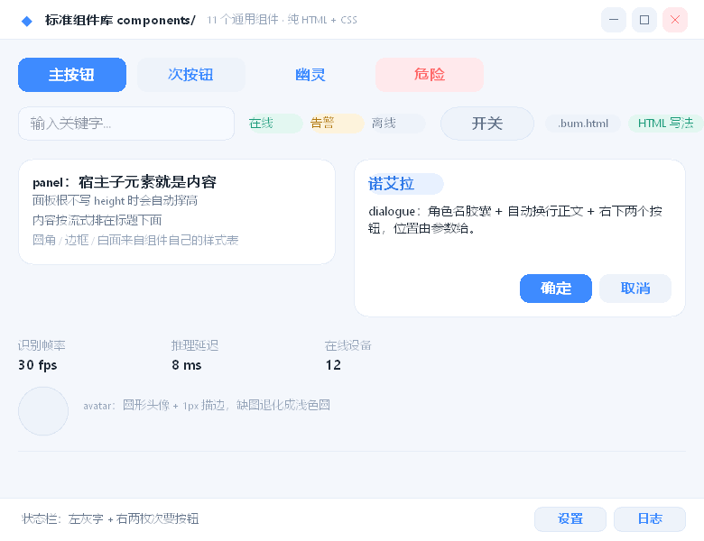

# components/ —— binUI 标准组件库

一批**与具体界面无关**的通用组件，全部用 HTML 标签 + CSS 写成，不含任何 C++ 代码。
在布局里用 `<use src="路径/xxx.bum.html" .../>` 引用，编译期内联成一个普通节点树
（运行期零开销、零依赖）。

```html
<use src="../../components/titlebar.bum.html" x="0" y="0" w="960" z="100"
     icon="◆" iconw="22" title="我的应用" sub="按 ESC 退出"
     idmin="btnMin" idmax="btnMax" idclose="btnClose"/>
```



`preview.html` 就是这张图的源码（也是冒烟测试：改完组件先跑它）。
渲染成图：

```sh
build-mingw/bin/offscreen_render components/preview.html docs/img/std-components.png
```

`src` 按**宿主 UI 文件所在目录**解析，所以从 `examples/<demo>/main.html` 引用就是
`../../components/`。也可以把整个目录拷到你的工程里，或编成 `.bum` 二进制再分发
（二进制优先、源码更新则优先源码，见 `docs/components.md`）。

拷贝时**整个目录一起拷、保持相对位置**：`external` 外挂组件和组件图片的路径最终相对宿主
`.bui` 解析，只搬 `main.bui` 不搬组件目录会挂不上（目录怎么摆见
[docs/components.md 第十一节](../docs/components.md)）。

标签只有 `<use>`（`<component>` 是旧别名，`<include>` 不存在）；每种组件都是**单一根元素**。

## 清单

| 组件 | 根标签 | 主要参数 | 说明 |
|---|---|---|---|
| `titlebar.bum.html` | `<titlebar>` | `title` `titlew`(默认 `content`) `sub` `icon` `iconw` `h` `pad` `padr` `bs` `gap` `idmin` `idmax` `idclose` | 窗口标题栏：**左**图标/标题/副标题，**右**最小化— 最大化▢ 关闭✕。flex 排版，多宽都不用算按钮坐标；根是 `<titlebar>`，所以拖动窗口照常生效。三颗控制按钮同尺寸（`bs`=29），**图标是元素画的**（1px 横条 / 1px 边框方框 / svg 两条对角线，都是 9×9 且中心对齐），左侧图标不做动画。根元素带 **`ui_scale="fixed"`**：`ui_scale="proportional"` 的窗口最大化/拉伸时标题栏不被拉变形（按钮仍是正方形）。**三颗按钮只有外观，动作归宿主**——按 `idmin`/`idmax`/`idclose` 拿节点 id，在 CLICK 事件里调 `app.minimize()` / `app.maximize()` / `app.requestExit()`（`examples/*/main.cpp` 都是这么接的） |
| `button.bum.html` | `<button>` | `label` `kind`(primary/secondary/ghost/danger) `w` `h` `fs` `r` | 四套外观，自带 `:hover`/`:active` |
| `field.bum.html` | `<input>` | `ph` 占位符 `val` 初值 `w` `h` `fs` `pad` | 单行输入框，聚焦转白底 |
| `badge.bum.html` | `<span>` | `text` `kind`(blue/mint/amber/red/gray) `w` | 状态胶囊 |
| `toggle.bum.html` | `<button>` | `label` `w` `h` | 勾选胶囊，`:checked` 变薄荷底（外壳调 `setNodeChecked`） |
| `panel.bum.html` | `<div>` | `title` `pad` `w` `h` | 卡片面板；**宿主子元素会排进面板里**（见下） |
| `dialogue.bum.html` | `<div>` | `name` `text` `ok` `cancel` `w` `h` | 对话气泡卡：角色名胶囊 + 自动换行正文 + 两个按钮 |
| `stat.bum.html` | `<div>` | `k` `v` `w` `h` | 指标单元（小标签 + 加粗数值） |
| `avatar.bum.html` | `` | `src` `size` | 圆形头像，缺图退化成浅色圆 |
| `divider.bum.html` | `<div>` | `len` `color` | 1px 分隔线 |
| `tag.bum.html` | `<span>` | `text` `kind`(blue/mint/amber/gray) `w` `fs` | 小标签 |
| `statusbar.bum.html` | `<div>` | `text` `b1` `b2` `h` `bw` | 底部状态栏（左灰字 + 右两枚次要按钮） |

## 源码格式：`.bum.html`（推荐）

组件源码一律用 **`.bum.html`** —— 和主 UI 的 `main.html` 同一套语法、同一个元素解析器：
`<style>` 并表、`class`/伪类/`attr()`、`{{参数}}`、嵌套 `<use>` 全都一样。

```html
<use src="../../components/tag.bum.html" x="16" y="20" w="90" text="显式扩展名"/>
<use src="../../components/tag.bum"      x="16" y="60" w="90" text="裸名字也行"/>
```

裸名字时的候选顺序：`<名字>.bum`（二进制）→ `<名字>.bum.html` → `<名字>.bum.xml`（旧写法）
→ …（二进制优先，源码比二进制新则用源码）。

> `.bum.xml` **仍然识别、能力完全一样**，只是历史写法：编译器从不按扩展名选解析器
> （看内容，见 `binui_compiler.cpp` 的 `CompileBinUIEx`），所以 "xml" 这个名字不带任何
> 额外能力。新写的组件用 `.bum.html` 就行 —— 别被后缀骗了。

## 三条使用约定

1. **参数别写进 `<style>`**。组件的 `<style>` 会并入宿主样式表，是**全局**的：两个实例
   传不同的值，后写的会盖掉前面的。所以所有可调值都走内联 `style`（内联优先级最高），
   `<style>` 里只放"同一套皮肤"的固定规则。
2. **组件的根标签就是节点的语义**。根写 `<button>` 才是可点击按钮、根写 `<input>` 才有
   占位符/编辑、根写 `<titlebar>` 才能拖动窗口 —— 编译器会把根标签原样搬过来
   （以前一律当成 `div`，组件里的按钮其实不可点）。
3. **符号字形要挑系统字体覆盖得到的**。三颗窗口按钮用的是 `−`(U+2212) `□`(U+25A1) `✕`(U+2715)：
   原来最小化用的是制表符 `─`(U+2500)，它只在中文字里有、Segoe UI 没有，GL/D3D 图集按
   "非 ASCII→中文字体"分类时笔画极淡，看起来像一个空按钮。`tests/test_font.cpp` 里有一条
   断言守着这件事（四个 UI 符号至少有一个候选字体画得出笔画）。
4. **宿主子元素会落进组件根容器**。`panel` 就是靠这条工作的：
   ```html
   <use src="../../components/panel.bum.html" x="16" y="56" w="320" title="统计">
       <span style="height:20">一行内容</span>
   </use>
   ```
   它们按流式排在组件自带内容之后，面板会自动撑高（根不写 `height` 时）。

## 样式令牌

所有组件共用一套浅色令牌，写在各自 `<style>` 的固定规则里：
页面底 `#F4F7FC` / 面 `#FFFFFF` / 线 `#E6EDF7`、`#DCE5F2` / 主字 `#1F2A37` /
次字 `#66768C` / 弱字 `#94A3B8` / 主色 `#3E8BFF`（悬停 `#5DA0FF`、按下 `#2F79E8`）/
薄荷 `#2FBF9A` / 琥珀 `#F2B544`。要换肤就改这些常量，或在宿主里用同权重更高的
选择器覆盖（例如 `#btnClose { ... }` 会压过组件的 `.bui-tb-close`）。

## 已知限制

- 组件不能条件渲染（没有 `if`）：`titlebar` 的 ─ 和 ✕ 永远成对出现、同尺寸（`bs`）。
  不想要最小化按钮，就把 `titlebar.bum.html` 复制一份删掉那一行 —— 这也正是"组件是源码"的好处。
- 组件没有插槽语法，宿主子元素只能落在根容器的流式末尾（不能塞进某个具名位置）。
- `:hover` / `:active` 的状态样式只能改底色/缩放/圆角，不能改文字色 —— 所以次按钮的悬停是"底色加深"。
- `box-shadow` 自 v0.16.14 起引擎支持（`apps` 是个示例，组件库里还没逐个加）—— 现在可以给卡片/弹窗加柔影，不必只靠 1px 边框 + 色差。
