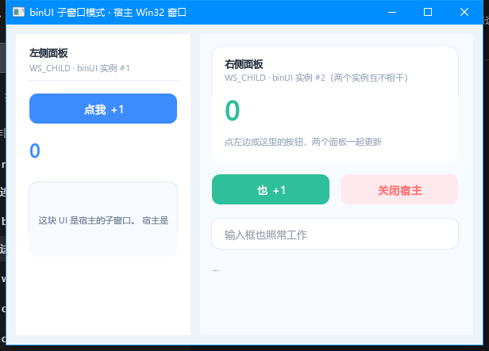

# 在其他语言里使用 binUI

binUI 引擎是 C++ 库（`namespace binui`、`std::function`、异常语义），直接跨 FFI
会踩一串语言各自的坑。所以真正对外的门只有一扇：**`include/binui_c.h` 的 C ABI**。

```
        .html / .xml
             │  binui_compile / binui_compile_file()（构建期或运行期都行）
             ▼
        .bui 二进制布局  ←── 纯数据，任何语言都能读写、能随包分发
             │  binui_app_create() / binui_app_open()
             ▼
   ┌─────────────────────────────────────────┐
   │ binui_c.dll  (Windows / OpenGL 3.3)     │
   │   布局解析 · 命中测试 · 滚动 · 动画      │
   │   文本编辑 · 组件挂载 · 脏矩形重绘       │
   └─────────────────────────────────────────┘
             ▲  binui_pump / binui_poll_event / binui_set_text
             │
   Python (ctypes) · Go (cgo) · Rust (extern "C") · C · 任何能调 C 的语言
```

## 三条设计约束

改 ABI 之前先读这三条 —— 绑定能不能"一个模子"写出来全靠它们：

1. **结构体只用定长类型**：`int32_t` / `uint32_t` / `float`。没有 `bool`（C 是
   1 字节、C# 默认 4 字节）、没有 `enum`（宽度随编译器）、没有 `size_t` / `long`
   （32/64 位会变）。所有结构体天然 4 字节对齐，不需要 `#pragma pack`。
   已用 `tests/test_capi.cpp` 把 `sizeof` / `offsetof` 钉死。
2. **没有跨语言回调**。事件全部走 `binui_poll_event()` 轮询 —— 宿主不进引擎的
   调用栈，就没有线程亲和、GC 保活、重入这些问题；PHP/Ruby 这类没有稳定回调
   机制的语言也能用。
3. **字符串一律 UTF-8**。取文本用 `(buf, cap)` 两段式（返回所需长度，和
   `snprintf` 一个习惯），不返回需要宿主释放的指针。

## 最小流程

```c
void* app = binui_app_create(layout_bytes, layout_len, "ui_dir/");  // 加载 .bui
binui_app_open(app, 0, 0, BINUI_OPEN_RESIZABLE, "标题");            // 建窗（0=用布局自带的尺寸）
while (binui_pump(app, 8) == 0) {          // 8ms 超时：空闲不烧 CPU
    BinUIEvent ev;
    while (binui_poll_event(app, &ev)) {
        if (ev.type == BINUI_EV_CLICK) { /* ev.node_id 是谁被点了 */ }
    }
}
binui_app_destroy(app);
```

`binui_pump()` 内部做四件事：收 Win32 消息 → 推进动画/视频时钟 → 重绘脏矩形 →
返回。宿主不需要知道 GL、不需要知道消息循环，也不需要自己算脏区。

## 运行期能力：滚动 / 节点几何 / 动态节点

C ABI 的默认口径是"**布局编译期定死，运行期只改内容**"（`set_text` / `set_visible` /
`set_checked` / `set_image`）。这对静态面板够用，但一写成列表 / 聊天流就不行了 ——
追一条消息要滚到底、消息高度不固定、条目数运行期才知道。这三件事对应下面这组接口：

| 需求 | C ABI | Python | Go | Rust |
|---|---|---|---|---|
| 滚到底 | `binui_scroll_to(app, id, x, y)` | `scroll_to` | `ScrollTo` | `scroll_to` |
| 相对滚动 | `binui_scroll_by(app, id, dx, dy)` | `scroll_by` | `ScrollBy` | `scroll_by` |
| 内容总高 | `binui_content_height(app, id)` | `content_height` | `ContentHeight` | `content_height` |
| 宿主自己排版 / 撑高 | `binui_set_node_bounds(app, id, x, y, w, h)` | `set_node_bounds` | `SetNodeBounds` | `set_node_bounds` |
| 追加节点 | `binui_add_node(app, parent, type, x, y, w, h, color, radius, fontSize)` | `add_node` | `AddNode` | `add_node` |
| 移除节点 | `binui_remove_node(app, id)` | `remove_node` | `RemoveNode` | `remove_node` |

典型用法（追加一条消息并贴底）：

```python
row = app.add_node(list_id, binui.NODE_LABEL, 0, y, 320, 20, 0xFF202225, 4, 13)
app.set_text(row, "很长的消息……")          # heightAuto 节点会自动重算高度
app.scroll_to(list_id, 0, app.content_height(list_id) - 视口高)
```

三条限制（都是"不做",不是 bug）：

1. **运行期新增的节点不参与 `set_size` 的百分比 / flex 重排** —— 重排只认静态布局里的
   缩放规格段；
2. **新增节点不会自动给兄弟节点让位**，位置由调用方给的 `(x, y)` 决定，后续节点要自己挪；
3. **`binui_remove_node` 只是隐藏**，节点留在表里供复用，id 不会被回收
   （所以"删了再加"不会无限涨节点数）。

### `set_text` 会重算高度，但只对"高度是自动撑开"的节点

编译期没写 `height` 的文本节点，高度是按文本估出来的，规格段里带 `heightAuto` 标记；
运行期 `set_text` 会按**同一套口径**（CJK 1.0× / 拉丁 0.52×字号，行距取 `line-height`）
重算，并保证不低于元素的默认盒高。作者显式写了 `height` 的节点不重排 ——
需要自己撑高就用 `binui_set_node_bounds`。

### 滚动条样式

滚动条是后端自绘的，颜色/宽度由渲染器提供：

```c
binui_set_scrollbar_style(app, 0xFFE5E7EBu /*轨道*/, 0xFFC7CBD1u /*滑块*/, 10 /*宽 2..32*/);
binui_reset_scrollbar_style(app);   // 回到自动派生
```

不调用时按**根节点底色亮度**自动派生：浅底给浅色轨道/滑块，深底给深灰 ——
所以浅色主题下不会再出现"右边一条黑杠"。CSS 的 `scrollbar-color` / `scrollbar-width`
仍然不支持，写了会得到一条编译警告（指向这个接口）。

## 各语言

| 语言 | 目录 | 机制 | 状态 |
|---|---|---|---|
| C / C++ | `include/binui_c.h` | 直接 include + `libbinui_c.a` | ✅ `tests/test_capi.cpp` 覆盖 |
| **Python** | [`bindings/python/`](../bindings/python/README.md) | `ctypes`（标准库，零依赖） | ✅ 跑通（本机 3.12） |
| **Go** | [`bindings/go/`](../bindings/go/README.md) | `cgo` + import lib | ✅ 跑通 |
| **Rust** | [`bindings/rust/`](../bindings/rust/README.md) | `extern "C"` + 手写声明（不依赖 bindgen） | ✅ 见下 |

三个绑定的 API 形状是一样的：`New/compile → open → loop { pump; poll }`，
返回值/错误处理各自本地化。要看最完整的例子直接读
[`bindings/python/binui.py`](../bindings/python/binui.py)。

## 构建 C ABI 产物

```sh
mingw32-make SHELL=sh capi
# build-mingw/libbinui_c.a         静态库：C / C++ / Rust 直接链
# build-mingw/bin/binui_c.dll      动态库：Python ctypes / Go cgo
# build-mingw/bin/libbinui_c.dll.a DLL 的 import lib（Go/Rust 链接用）
```

CMake 侧对应 `binui_c`（静态）与 `binui_c_shared`（动态）两个目标，仅 Windows 构建。

**产物是自包含的**：`Makefile` 里 `RTLINK := -static-libgcc -static-libstdc++`，
FreeType / HarfBuzz 也都走静态库（`third_party/*/build-static`），所以除系统 DLL
（`gdiplus` / `opengl32` / `dwmapi` / `user32` / `gdi32`）外不用附带任何第三方运行时。
Python 用户不会撞上经典的 `OSError: [WinError 126] 找不到指定模块`。

⚠️ 链接时别误用 `third_party/harfbuzz/build/src/libharfbuzz.dll.a` —— 那套会拖进
`libharfbuzz-0.dll`。用 `build-static` 那份。

⚠️ DLL 被宿主进程加载期间**无法重新链接**（Windows 文件锁）。改完引擎先关掉宿主
程序再 `make capi`，否则报 `cannot open output file binui_c.dll: Permission denied`。

## 线程与窗口

- 窗口必须在**创建它的那个线程**上 `pump` / `render` / `resize` / `destroy`。
  Win32 与 WGL 都有线程亲和，这不是"线程安全"问题，是 API 契约。
  违反了**不会当场报错**，而是随机 AV 或退出时挂死（[issues/08](issues/08-go-binding-thread-affinity.md)
  就是这条：宿主没锁线程，崩在 `binui_app_destroy` 里，被误当成库的 bug）。
- 本库自己拦了一道：`binui_pump` / `binui_render` 在非建窗线程上调用时返回 **-1**
  （并往 stderr 打一行说明），`binui_app_destroy` 会先打警告再执行。
- 各语言的正确写法：

  | 语言 | 做法 |
  |---|---|
  | Python | 主循环天然在同一线程，不用管 |
  | Go | **`main` 里也必须 `runtime.LockOSThread()`** —— main goroutine 会在安全点被调度到别的 M，只加在子 goroutine 上不够。直接用 `binui.RunMain(func() int { … })` 包一层 |
  | Rust | 绑定刻意不给 `App` 实现 `Send`，编译期就挡住 |
  | C/C++ | 自己在同一个线程里跑循环即可 |

- 两种形态：**独立顶层窗**（`binui_app_open` + `binui_pump`）和**子窗口/控件**
  （`binui_app_open_child` + `binui_render`）。后者见下一节。

## 事件表（C ABI v3 / v0.14.0）

所有事件走同一个队列：每帧 `binui_pump` 之后 `while (binui_poll_event(app, &ev)) { … }`。
v3 把引擎侧补齐的事件全部映射过来了（字段含义见 `binui_c.h` 的 `BinUIEvent`）：

| `type` | 字段 | 什么时候来 |
|---|---|---|
| `BINUI_EV_CLICK` | `node_id` `x` `y` | 点击/键盘激活 |
| `BINUI_EV_DBL_CLICK` | `node_id` `x` `y` | 同节点 400ms 内第二次点击 |
| `BINUI_EV_PRESS` / `BINUI_EV_RELEASE` | `node_id` `x` `y` `button` | 按下 / 松开（`RELEASE` 的 `node_id` = 按下时命中的节点）|
| `BINUI_EV_MOVE` | `node_id` `x` `y` | 每次移动（`node_id = -1` 表示空白处）|
| `BINUI_EV_CONTEXT_MENU` | `node_id` `x` `y` | 右键按下 |
| `BINUI_EV_HOVER` / `BINUI_EV_HOVER_LEAVE` | `node_id` | 进入 / 离开节点（离开含移出窗口）|
| `BINUI_EV_FOCUS` | `node_id` `focused` `prev_id` | **键盘焦点**变化（0=失去，1=获得）|
| `BINUI_EV_EDIT` | `node_id` `editing` | 进入 / 退出文本编辑 |
| `BINUI_EV_INPUT` | `node_id` `text` | 编辑中逐字（含 IME 上屏）|
| `BINUI_EV_CHANGE` | `node_id` `text` | 提交（失焦或 Enter 退出且有改动）|
| `BINUI_EV_SCROLL` | `node_id` `x` `y` `dx` `dy` | 滚动位置变化（新位置 + 本次增量）|
| `BINUI_EV_WHEEL` | `node_id` `x` `y` `dy` | 滚轮 |
| `BINUI_EV_RESIZE_START` / `BINUI_EV_RESIZE_END` | `node_id`；END 另带 `x/y/width/height` | 拖元素尺寸开始 / 结束（最终矩形）|
| `BINUI_EV_RESIZE` | `width` `height` | 窗口尺寸 |
| `BINUI_EV_KEY` / `BINUI_EV_CHAR` | `key` / `text` | 按键 / 字符 |
| `BINUI_EV_CLOSE` | — | 窗口关闭 |
| `BINUI_EV_ANIM_END` / `_ITER` / `BINUI_EV_TRANS_END` | `node_id` `iteration` / `prop` | 动画结束 / 迭代 / 过渡结束 |
| `BINUI_EV_LOAD` | — | 布局加载完成 |

> 右键/中键需要外壳把按键号交出来：`binui_app_open` 那套外壳已经处理
> `WM_RBUTTONDOWN/UP`、`WM_MBUTTONDOWN/UP`，宿主在 `setButtonFn` 里转手
> `renderer.press(x, y, button)` / `release(x, y, button)` 即可（引擎据此派发
> `CONTEXT_MENU`）。左键仍走原来的 `setPressFn` / `setReleaseFn`。

## 动画事件（v0.13.1 / C ABI v2）

引擎里 `stepAnimations()` 只会告诉你"这一帧哪些节点变了"，**不告诉你动画结束没结束**——
于是编排（串下一段动画、动画完了再切页）只能自己按 `durationMs` 定时，等于把引擎的时间轴
再实现一遍，`delay` / `iteration` / `direction` 一变就对不上。

现在每帧 `takeAnimEvents()` 取一次，三种事件：

| 引擎 | C ABI | 含义 |
|---|---|---|
| `AnimEventKind::ANIM_END` | `BINUI_EV_ANIM_END` | 关键帧动画整体结束（`iteration` = 次数；`infinite` 不报） |
| `AnimEventKind::ANIM_ITERATION` | `BINUI_EV_ANIM_ITER` | 迭代边界（`iteration` = 已完成的第几次，1 起） |
| `AnimEventKind::TRANSITION_END` | `BINUI_EV_TRANS_END` | 某属性过渡结束（`prop` = `ANIM_*`：缩放/透明度/颜色/圆角/平移） |

要点：

- **是"取"不是"回调"**。事件在 `stepAnimations()` 内部产生，而宿主常在同一条路径上改样式/
  删节点，回调会就地重入 —— 和 `takeResizeDirty()` 同一个理由。C 侧不用管：库把它们排进
  同一个队列，照旧 `binui_poll_event` 轮询。
- **同一帧跨多次迭代只报一次**（带当前次数），不会因为卡顿刷屏。
- **`restartAnimations()` 会丢掉排队中的旧事件**（旧时间轴上的"结束"已经没有意义）。
- `fill-mode` 不影响事件：`forwards` 与否，结束都报；报完仍按既有规则保持终值。

## 键盘与中文输入

文本框的编辑**由库内部处理**：WASD 移动焦点、方向键滚页面、输入框上 Enter 进入编辑、
再按 Enter/Esc 退出回到焦点控制、Tab 退出并跳到下一个控件，宿主不用重写一遍，结果通过
`BINUI_EV_INPUT` 推出（编辑过程中逐字推，失焦时提交）。焦点环分三态：输入框待编辑是虚线、
按钮等普通焦点是实线（均 2 秒无操作自动熄灭、鼠标点击不画），编辑中是实线蓝色、常亮
（只有键盘 Enter 进入的编辑才画：鼠标点进输入框直接编辑，不画环）；
`BINUI_EV_KEY` 照旧推给宿主（Esc 关窗这类库不消费的键由宿主自己处理）。C ABI 内部已经把
IME 开关接在编辑态上（非编辑态摘掉输入法，否则中文输入法会把 WASD 变成 `VK_PROCESSKEY`
自己组字、焦点导航全哑）。完整按键表见 [`keyboard_focus.md`](keyboard_focus.md)。

> 2026-10 修的一个真 bug：三个窗口外壳原来用 ANSI 窗口类（`RegisterClassA` +
> `DispatchMessageA`），在 CP936 系统上 Windows 会把一个中文字符拆成**两个**
> `WM_CHAR`（DBCS 字节），于是输入框里打「中」得到「ÖÐ」。改成 Unicode 窗口
> （`RegisterClassW` + `DispatchMessageW`）后，中文与代理对（emoji）都正常。
> 这条也算"为什么绑定值得做"的注脚 —— 光靠 C++ demo 发现不了，得真在别的语言里
> 打一遍字。

**输入法排查（`BINUI_IME_LOG=1`）**：设了这条环境变量，窗口会把收到的
`WM_KEYDOWN` / `WM_CHAR` / `WM_IME_*` 消息序列追加到工作目录下的 `binui_ime.log`。
输入法的问题基本只能靠消息序列定位（谁是组字、谁把键吃了、候选窗该不该收），
日志里只有消息号和参数，不含输入内容。

**输入法候选窗**：GL 外壳处理 `WM_IME_STARTCOMPOSITION` / `WM_IME_COMPOSITION`，
用 `ImmSetCompositionWindow`（`CFS_POINT`）把组字窗口摆到光标处、
`ImmSetCandidateWindow` 把候选窗列在光标下方。以前完全没处理 —— 中文能上字，但候选窗
会飘在屏幕角落。组字内容本身仍由系统绘制（不抢 `DefWindowProc`）。

## 子窗口模式：作为控件嵌进宿主窗口

顶层窗是"binUI 自己当应用"；子窗口模式是"binUI 当你窗口里的一块控件"——
WPF / Qt / WinForms / 自己的 C++ 窗口里塞一块 binUI 面板，走的就是这条。

```c
void* app = binui_app_create(layout, len, "ui/");
binui_app_open_child(app, host_hwnd, /*x*/12, /*y*/12, /*w*/220, /*h*/380, 0);

// 宿主自己的消息循环；binUI 绝不碰消息队列
while (GetMessage(&msg, NULL, 0, 0)) {
    TranslateMessage(&msg);
    DispatchMessage(&msg);      // 鼠标/键盘在这里被投递到 binUI 子窗口
    binui_render(app);          // 出一帧：推进动画 + 绘制脏区
    while (binui_poll_event(app, &ev)) { /* … */ }
}
```

`binui_app_hwnd(app)` 拿到子窗口的 HWND —— 宿主布局（`SetWindowPos`）要用它。

### 和顶层窗的差别（只有这几处）

| | `binui_app_open` | `binui_app_open_child` |
|---|---|---|
| 窗口样式 | `WS_POPUP \| WS_MAXIMIZEBOX` | `WS_CHILD \| WS_VISIBLE \| WS_CLIPSIBLINGS` |
| 位置尺寸 | 自己算工作区居中 | 宿主给的 `(x, y, w, h)` |
| 消息 | `binui_pump()` 自己 `PeekMessage` | **`binui_render()` 只管出帧** |
| DPI | 自己 `SetProcessDPIAware` | 不碰（进程级策略归宿主） |
| 焦点 | 建窗后 `SetFocus` | 不抢（宿主可能正拿着焦点） |
| 标题栏拖动 / 边框缩放 / 最大化 | 内建 | 无效（都是宿主的生意） |
| 窗口级透明 | `WS_EX_LAYERED` | **不支持**（分层属性对子窗口无效） |

### 宿主必须做的一件事：`WS_CLIPCHILDREN`

宿主窗口创建时**一定要带 `WS_CLIPCHILDREN`**：

```c
CreateWindowExW(0, cls, title, WS_OVERLAPPEDWINDOW | WS_CLIPCHILDREN | WS_VISIBLE, ...);
```

不加的话宿主的 `WM_PAINT` 会把整个客户区刷一遍，**连子窗口那块一起刷掉**。GL 子窗口
没有留存面（它的像素不在父窗口的 GDI surface 里），于是表现就是"面板是白的、点得到但
看不见"。这是实测踩出来的：同一份代码，加 `WS_CLIPCHILDREN` 前后从"整块空白"变成
"两块面板各就各位"。

### 生命周期

- 宿主 `DestroyWindow` 自己窗口时，子窗口跟着被销毁：引擎在子窗口的 `WM_DESTROY` 里
  当场收摊（关 GL、标记关闭），**不会** `PostQuitMessage`（那会把宿主的消息循环干掉）。
- 之后 `binui_render()` 返回 1，宿主该停止渲染并 `binui_app_destroy()`。
- 换尺寸：宿主 `SetWindowPos` 子窗口即可（收到 `WM_SIZE` 后下一帧重排）；或者直接调
  `binui_resize(app, w, h)` 省掉一次消息往返。

### 已验证到什么程度

功能链路在本机跑通（宿主是一个普通 Win32 窗口，里面两块独立面板）：
点击两个面板各自的按钮 → 事件回到宿主语言、两块面板同时更新；输入框聚焦 + 输入中文
（`中文`）正常；点"关闭宿主"→ 子窗口 `WM_DESTROY` → `render()` 返回 1 → 进程干净退出。
参数字校验（NULL 父窗口 / 尺寸非法）进 `tests/test_capi.cpp`，CI 可跑。



（这是真机截屏：一个普通 Win32 宿主窗口，左边 220px 定宽面板、右边自适应面板，
两块各自是独立的 binUI 实例。）

⚠️ **同一个线程里开多个实例时，每帧必须切回自己的 GL 上下文**。WGL 的 current
context 是线程级的，谁最后 `init` 谁一直占着——不切回去，两块的绘制会全画到后建的那块
身上，先建的显示纯黑。引擎已在 `beginFrame()` / `present()` 里做
`wglMakeCurrent`（且先 `wglGetCurrentContext` 比对，已是自己就跳过），所以宿主不用管；
但如果你自己直接驱动 `BinUIGLGdi`，注意这一条。

## 没有跨过去的部分（明确不支持，不是 bug）

| 能力 | 原因 / 替代方案 |
|---|---|
| `<canvas>` 绘制回调 | 需要跨语言回调，与约束 2 冲突；宿主自己在窗口上画，或改用 `set_image_rgba` 推像素 |
| `<video>` 播放 | 解码模块 `BINUI_ENABLE_VIDEO=ON` 才编进去，另行挂载；帧可以走 `binui_set_image_raw` |
| 子窗口的逐像素透明 | `WS_EX_LAYERED` 对子窗口无效；要透明只能用顶层窗（`binui_app_open` + `OPEN_TRANSPARENT`） |
| D3D11 后端的子窗口 | GL-GDI 外壳已有 `openChild`；D3D11 侧照抄（swapchain 的 `OutputWindow` 填子 HWND）还没做 |
| 非 Windows 平台 | 核心库跨平台，**外壳不是**：GL-GDI 是 Win32 实现。要跨平台先补平台层 |

## 新增一门语言要做的

1. 照着 `include/binui_c.h` 写一遍声明（结构体字段顺序别动）。
2. 字符串用 `(ptr, len)` 而不是只看 NUL。
3. `binui_last_error()` 转成本地错误类型。
4. 写一个 demo：编译 UI → 建窗 → 循环 pump/poll → 点一个按钮改一行字。
5. 如果这门语言有 struct 布局检查能力，把 `sizeof(BinUINode) == 56`、
   `sizeof(BinUIEvent) == 48` 断言进去（Rust 的 `_assert_layout()` 就是干这个的）。
