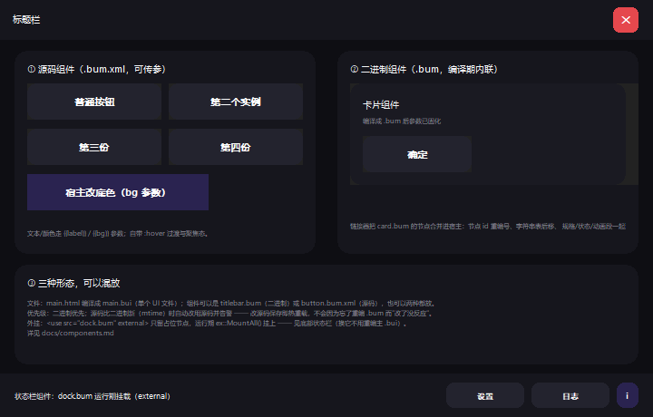

# 组件化：`.bui` / `.bum` / `.bum.xml`

> 一句话：**一个界面 = 一个 `.bui`（单文件，组件全内联）；想拆开就拆成 `.bui` + 若干 `.bum`，
> 二进制和源码可以混放，加载时二进制优先、源码用于改和热更新。**



示例：[`examples/components/`](../examples/components/)（上图就是它渲染出来的）。
标题栏 `titlebar.bum`（二进制）、按钮 `button.bum.xml`（源码 + 参数）、卡片 `card.bum`（二进制，
内部又引用过源码组件）、状态栏 `dock.bum`（`external`，运行期挂载）。

## 一、命名与分发形态

| 文件 | 含义 | 谁读 |
|---|---|---|
| `main.bui` | 完整界面布局（**应用入口**，`loadLayout` 直接吃） | 外壳 |
| `main.bui.xml` | 上面那份的源码（也接受 `main.html`） | 编译器 |
| `titlebar.bum` | 组件二进制布局 | 链接器（编译期内联）/ 渲染器（运行期挂载） |
| `titlebar.bum.xml` | 组件源码（可读、可编辑、可热重载） | 编译器 |
| `.binui` | `.bui` 的旧名，仍然识别（兼容历史示例） | 同 `.bui` |

三种分发方式都成立，作者按需选：

```
单个 UI（内嵌，一个文件）        main.bui
组件式（外挂）                  main.bui + titlebar.bum + button.bum
混放（部分二进制、部分源码）     main.bui + titlebar.bum + button.bum.xml
双份（二进制优先，源码可改）     main.bui + button.bum + button.bum.xml
```

“组件全内联”的 `main.bui` 运行时**不需要任何外部文件**（图片仍在外面，路径记在布局自带的资源段里）。

## 二、三条组装路线

| 写法 | 组装时机 | 用什么 | 特点 |
|---|---|---|---|
| `<use src="x.bum.xml">` | 编译期 | 源码内联（文本替换 + 元素合并） | 支持 `{{参数}}`；宿主能主题化组件 |
| `<use src="x.bum">` | 编译期 | 链接器离线合并 | 不暴露源码；参数在编 `.bum` 时已固化 |
| `<use src="x.bum" external>` | **运行期** | `binui::ex::MountAll()` | 换组件不用重编主 `.bui`（皮肤/插件） |

前两条产出同一个 `.bui`，运行时零开销、零依赖；第三条在布局里只留一个占位节点 +
一条“组件引用”记录（v12 组件引用段），外壳启动时挂上去。

## 三、基本用法

```html
<!-- 宿主 main.html（编译成 main.bui） -->
<use src="titlebar.bum"    x="0" y="0" w="720"/>                        <!-- 二进制，编译期内联 -->
<use src="button.bum.xml"  x="16" y="44" w="132" label="确定"/>          <!-- 源码，可传参 -->
<use src="card.bum"        x="16" y="96" w="304"/>                      <!-- 二进制，编译期内联 -->
<use src="dock.bum" external x="0" y="412" w="720"/>                    <!-- 外挂，运行期挂载 -->
```

```html
<!-- button.bum.xml：参数 + 自己的 :hover 过渡 -->
<style>
    .cmp-btn { color:#F5F5F7; border-radius:10; transition: background-color .18s ease; }
    .cmp-btn:hover { background:#3B2F63; }
</style>
<div class="cmp-wrap" style="height:40">
    <button class="cmp-btn"
            style="position:absolute; left:0; top:0; width:{{w=132}}; height:40;
                   background:{{bg=#23232E}}">{{label=按钮}}</button>
</div>
```

```cpp
// 外挂组件：布局里只有占位节点，这一步把它们挂上（幂等，可重复调用）
renderer.loadLayout(bytes.data(), bytes.size());
binui::ex::MountAll(renderer, binui::ex::DirOf(uiPath), renderer.layoutBytes());
```

`MountAll` 会按第二节的规则解析每个引用：`.bum` 直接读、只有 `.bum.xml` 时就地编译，
并打印挂载统计。`--watch` 热重载后重新调用一次即可（示例就是这么做的）。

## 四、加载优先级（二进制优先，源码优先更新）

规则只在一个地方实现：[`include/binui_asset.h`](../include/binui_asset.h)，
编译器与运行期加载器共用同一份。

| 情况 | 用哪个 | 说明 |
|---|---|---|
| 只有 `.bum` | 二进制 | 直接合并 |
| 只有 `.bum.xml` | 源码 | 编译期内联（可传参） |
| 两者都在，`.bum` 不旧 | **二进制** | “优先加载二进制的” |
| 两者都在，源码 mtime 更新 | **源码** + 告警 | 防止“改了源码没重编 `.bum` → 改了没反应” |
| 写 `src="x"`（无扩展名） | 依次探测 | `x.bum` → `x.bui` → `x.bum.xml` → `x.bui.xml` → `x.html` → `x.xml` |

扩展名只作提示，最终按文件头 magic（`BINU` / `XHTM`）判定——把 `.bum` 改名成 `.xml`
也不会误把二进制当源码解析。

## 五、参数

- `{{name}}`：用 `<use>` 上的同名属性替换；未提供 → 空串 + **编译警告**。
- `{{name=默认值}}`：可缺省，未提供时用默认值，不报警告。
- **单独编 `.bum` 时按默认值代入**（裸 `{{name}}` 原样保留）——所以带默认值的组件
  既能被内联传参，也能自己编成 `.bum`，两种形态语义一致。
- **参数值按纯文本注入**（`& < >` 转义）：传 `"内部 <use>"` 只是一段文字，不会变成真元素。
- 参数名大小写不敏感（HTML 属性名本来就小写化）。

二进制组件的参数在编 `.bum` 时就固化了；宿主还能覆盖的是**外框**：`<use>` 上的
`w` / `h` / `bg` / `radius`（链接器改的是组件根节点）。要可变的文字/配色，
要么用源码形式，要么给每种配置编一份 `.bum`。

## 六、链接器做了什么（内联与外挂共用）

[`include/binui_link.h`](../include/binui_link.h) 的 `MergeLayout()` 是唯一实现，
`binui_compile`（离线）和 `renderer.mountComponent()`（在线）都调它：

| 项 | 处理 |
|---|---|
| 节点 id | 重新编号（宿主最大 id + 1 起），整棵挂到锚点节点下 |
| 组件根 | 组件里那个“合成根”（`html/body` 包裹层）丢弃，其子节点改挂锚点 |
| 坐标 | 组件坐标从 (0,0) 起算，整体平移到锚点内容原点（节点坐标是绝对屏幕坐标） |
| 占位节点 | 按组件包围盒撑大——外壳会按祖先矩形裁剪子节点，不撑大就会被裁掉一块 |
| 字符串表 | 整体后移，重算节点文本 / 视频 src / 图片路径 / 名称的偏移 |
| 缩放规格段 | 合并（`%`/flex/auto 在宿主窗宽下重排照旧） |
| 状态样式段 | 合并（组件的 `:hover`/`:active` 在宿主里照常生效） |
| 动画段 | 关键帧组整体后移，动画定义的组下标跟着补 |
| 视频/资源段 | 视频描述合并；资源下标整体重排（`imageIndex` 一起改） |
| 组件引用段 | 递归合并（组件里还能外挂组件） |
| 名称段 | 合并；同名以宿主为准（组件不能顶掉宿主的 `#id`） |
| 窗口描述段 | 不动（宿主保留自己的标题/尺寸/背景） |

失败时宿主保持不变并给出原因（`err`），不会留下半个组件。

## 七、命令行

```bash
# 组件源码 -> 二进制组件
binui_compile titlebar.bum.xml                 # -> titlebar.bum（同目录）
binui_compile main.html -o build/main.bui      # 单文件界面

# 已经是二进制就原样拷贝，方便两条流水线共用一条命令
binui_compile titlebar.bum -o dist/titlebar.bum
```

构建集成：`make components` 把 `examples/components/*.bum.xml` 编成
`build-mingw/assets/components/*.bum`；CMake 里是 `components_bums` 目标
（`cmake --build . --target components_bums`）。产物不落源码树。

## 八、两个必须知道的坑

1. **组件自带的 `<style>` 是全局的**（并进宿主样式表）：好处是宿主能主题化组件，
   坏处是选择器互相影响——组件内的类名请加前缀（示例统一 `.cmp-`）。
2. **参数化的样式不要写在 `<style>` 里**：样式表全局共享，多个实例会互相覆盖；
   参数化的样式写内联 `style`。

```html
<!-- ❌ 所有实例共用最后一个 bg -->
<style>.cmp-btn { background: {{bg}}; }</style>

<!-- ✅ 每个实例独立 -->
<button class="cmp-btn" style="background: {{bg=#23232E}}">…</button>
```

组件里的 `:hover` / `:active` / `:focus`、`@keyframes`、`::before/::after` 都照常工作。

## 九、资源路径

组件里的相对资源路径（``、`<video src>`、嵌套组件的 `src`）在合并时
**改写成宿主相对路径**：

```
examples/components/titlebar.bum.xml 里写 
  → 合并进 examples/components/main.html 后是 src="titlebar/icon.png"
```

图片清单还会写进布局的**资源段**（v12），所以外壳不必再额外保存编译期的图片列表：

```cpp
auto imgs = binui::ex::LoadLayoutImages(renderer, uiPath, "components"); // 按布局资源段找文件
renderer.setImageOrder(renderer.imagePaths());
renderer.loadResources(imgs);
```

## 十、已知限制

| 限制 | 现状 |
|---|---|
| 二进制组件的参数 | 编 `.bum` 时固化；宿主只能覆盖 `w/h/bg/radius` |
| `slot` / children 投影 | 未实现（组件里不能“把宿主的孩子插到这里”） |
| 组件作用域 CSS 隔离 | 未实现（CSS 全局，靠类名前缀约定） |
| 组件内 `<script>` | 忽略（没有脚本引擎） |
| 运行期卸载组件 | 未实现（挂载后只增不减，`loadLayout` 重来即可） |
