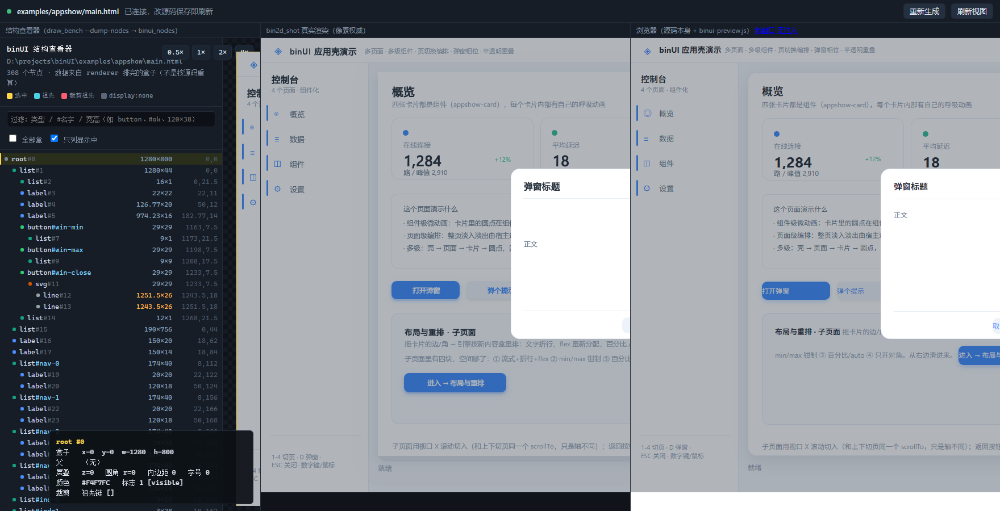

# binUI dev 服务：结构查看器 + 真实渲染 + 保存即刷新

`tools/binui_dev.py`。把"看布局"从三条命令变成"存一下就变"：

```sh
python tools/binui_dev.py examples/buttonshow/main.html
```

stdout **第一行**就是最终 URL（端口被占用会自动 +1，脚本可以直接抓这一行）：

```
http://127.0.0.1:8765/
```

浏览器打开就是三栏：**左边结构查看器**（`draw_bench --dump-nodes` + `tools/binui_nodes.py`）、
**中间 `bin2d_shot` 的真实渲染 PNG**（像素权威）、**右边浏览器渲染的同一份源码**
（注入 `tools/binui-preview.js`，组件内部结构由它在浏览器里展开）。改页面/组件/样式，
保存 → 自动重建 → 三栏一起刷新。



## 用法

```sh
python tools/binui_dev.py <page.html> [--port 8765] [--shot-only] [--no-initial-build]
```

| 参数 | 含义 |
|---|---|
| `<page.html>` | 页面路径（相对当前目录或绝对路径） |
| `--port N` | 起始端口，默认 8765；被占用就 +1 重试（最多 20 次） |
| `--shot-only` | 只出 `bin2d_shot` 的 PNG，不做结构查看器（页面上就是一张大图） |
| `--no-initial-build` | 启动时先不重建，等第一次请求 |

产物统一落 `out/dev/`（已在 `.gitignore` 里，服务**不写源码树**）：

```
out/dev/<name>.png         bin2d_shot 的真实渲染
out/dev/<name>.json        draw_bench --dump-nodes 的节点表
out/dev/<name>.view.html   binui_nodes 合成的结构查看器（服务以 /view 提供）
```

## 设置页背后的三条命令

服务本身不解析布局，只是把现成二进制串起来（和手敲一样）：

```sh
build-mingw\bin\bin2d_shot.exe <page> out\dev\<name>.png
build-mingw\bin\draw_bench.exe <page> --frames 2 --dump-nodes out\dev\<name>.json
python tools\binui_nodes.py <json> <png> -o out\dev\<name>.view.html
```

首屏一次完整重建约 **250~600 ms**（buttonshow、1020×684：shot ≈200ms + 节点 ≈10ms + 合成 ≈35ms），
之后只有文件变了才重建。

## 监听范围（mtime 每秒轮询，不引 watchdog）

1. 页面文件本身；
2. 它引用的组件：`<use src="...">` / `data-component="..."`（组件里再引组件会继续跟，最多 3 层）；
3. 页面里被引用的 `.css` / `.js`，以及**页面同目录**下的样式/脚本文件。

改了构件清单（比如新加一个 `<use>`）也不用重启，监听集合每次轮询会重算。

## 热刷新怎么工作（SSE）

- `/events` 是一条 SSE 流；服务端发现文件变化 → 重建 → 推一条 `data: reload`；
- 页面里的 `EventSource` 收到就重载 iframe 和 PNG（带 `?t=时间戳` 破缓存），顶栏显示第几次刷新；
- 断线自动重连（服务端发 `retry: 1000`，浏览器原生重连），断线时顶栏圆点变红并显示"自动重连中"；
- 心跳 `: ping` 每 15 s 一次，避免长连接被中间设备掐断。

其他路由：`/view`（结构查看器 HTML）、`/shot.png`（PNG）、`/api/rebuild`（强制重建，页面右上角
「重新生成」按钮用它）、`/api/state`（JSON：状态/重建次数/在线客户端数/页面路径/用到的组件清单，
便于脚本断言）、`/file/**`（仓库静态镜像，HTML 自动注入预览脚本）、`/__binui/preview.js`
（运行时脚本本体）、`/__binui/component?src=…`（组件源码解析）、`/__binui/c/<路径>`（组件独立视图）。

## 第三栏：浏览器里的同一份源码

右边那栏是 `/file/<页面相对路径>` —— 浏览器**直接读源码**，`binui dev` 只在 HTML 的 `</body>`
前塞了一行 `<script src="/__binui/preview.js" data-binui-dev>`。脚本干的事（细节见
[issues/15 §4 末](issues/15-valid-html-language.md)）：

1. 展开 `data-component`（fetch 组件文件 → 参数替换 → 片段顶层元素插到宿主子元素之前 →
   片段 `<style>` 并入 `<head>`）；
2. `data-binui-window` 的 `data-width/height/bg` 当窗口几何；
3. 注入与 binUI 对齐的基础样式（默认字体链、行高 1.35×、`box-sizing:border-box`、UA 清零）；
4. 三条语义补齐：绝对定位以父元素为包含块、行内标签拉成块级、展开期间关掉过渡。

改 `tools/binui-preview.js` 不用重启服务（每次请求现读）；改页面/组件照样走 SSE 热刷新。

### 组件独立视图（看 1px 描边就靠它）

```
http://127.0.0.1:8765/__binui/c/components/titlebar.bum.html?host=titlebar&flex=1&w=780&h=45&zoom=4&grid=1
```

| 查询参数 | 作用 |
|---|---|
| `zoom=1/2/4/8` | 视觉放大（浏览器按新尺寸重新光栅化，文字依然清晰）；键盘 `+ - 0` |
| `grid=1` | 盒边界（每个元素一圈虚线，宿主一圈实线）；键盘 `g` |
| `host=titlebar` | 宿主的标签（默认 `div`）—— 片段的根就是宿主，flex 排版要配 `flex=1` |
| `w=780&h=45&flex=1&gap=6px&bg=#fff` | 宿主盒的宽高/flex/间距/底色 |
| `text=标题` | 宿主文本（`data-param` 在没给对应 `data-*` 时用它当默认值） |
| 其余键 | 组件参数：同时写 `data-<名>` 和 `--<名>`，等于手写一行宿主 `style`。**长度要带单位**（`22px`），无单位在 CSS 里是非法值 |

`--debug=1` 把宿主与子元素的盒信息写进 `<pre id="binui-cdebug">`（headless `--dump-dom` 可直接读）；
`?noreload=1` 关掉 SSE —— headless 截图/抓 DOM 时必加，否则挂起的 SSE 连接会让
`--virtual-time-budget` 永远等不到空闲。


## 自己验证一次

```powershell
# 1) 起服务，抓第一行 URL
$p = Start-Process python -ArgumentList "tools\binui_dev.py","examples/buttonshow/main.html" -NoNewWindow -PassThru -RedirectStandardOutput out\dev\s.log
Start-Sleep 6; Get-Content out\dev\s.log -TotalCount 1

# 2) reload 是否真的推到客户端：挂一个 SSE 客户端，再 touch 源文件
python -c "import urllib.request;[print(l) for l in urllib.request.urlopen('http://127.0.0.1:8765/events',timeout=20) if b'reload' in l][:1]"
(Get-Item components\titlebar.bum.html).LastWriteTime = Get-Date   # 改组件也算
# 服务端日志会出现： [watch] 变化：components\titlebar.bum.html → [sse] 推送 'reload' → 1 个客户端
```

浏览器侧就更容易：把窗口摆着，改一下 `examples/buttonshow/main.html` 里任意一个数值保存，
右栏图、左栏树都会自己换，顶栏时间戳 +1。

## 已知边界

- **右栏不是像素权威**：它是浏览器对同一份源码的解释，用来验"写法在标准 HTML 里成立不成立"；
  像素以中间那栏（`bin2d_shot`）为准。逐页落差 3.9%~27%（文字度量 / 换行 / 阴影浓度 / 1px 抗锯齿），
  见 [issues/15 §4 末](issues/15-valid-html-language.md)。运行期状态（弹窗显隐、`:checked`、
  hover）在源码里没有位置，浏览器看到的是**静态形态** —— 和 `bin2d_shot` 的首帧一样。
- 预览脚本必须走 HTTP：`fetch` 组件文件在 `file://` 下被 CORS 拦，所以别直接双击 HTML，
  用 `binui dev` 给的那个 `/file/…` 地址。
- 编辑器"保存即触发"可能连发两次（临时文件 + 重命名），服务会重建两次；无副作用，只是多花 ~250 ms。
- 重建是串行的：正在重建时又改文件，这一轮会以最新内容为准（下一轮再触发一次）。
- 二进制被占用（`Permission denied`，通常是在 `make`）时自动重试一次并打日志。
- 只监听 `127.0.0.1`，不对外网暴露。
