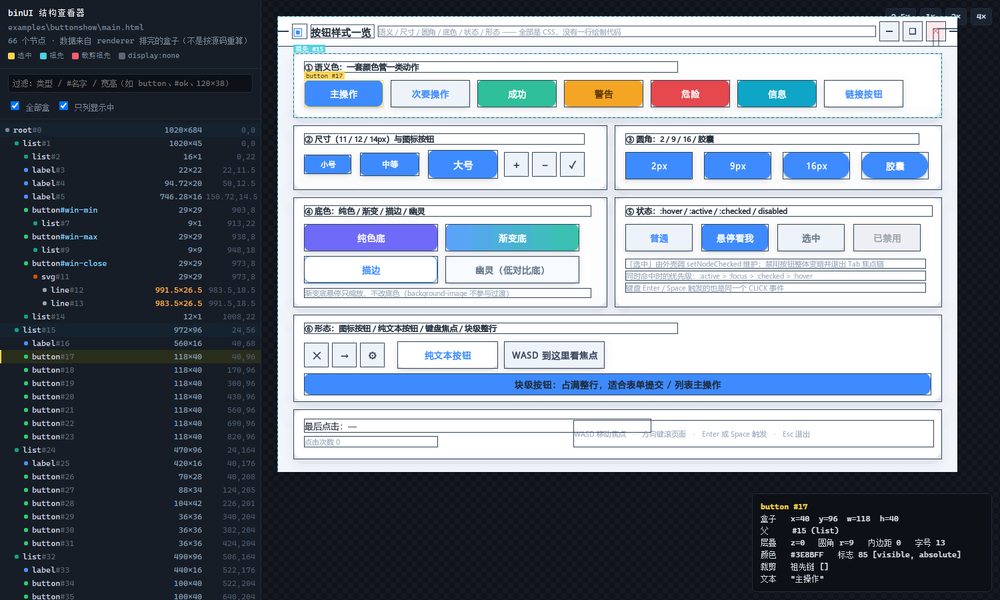
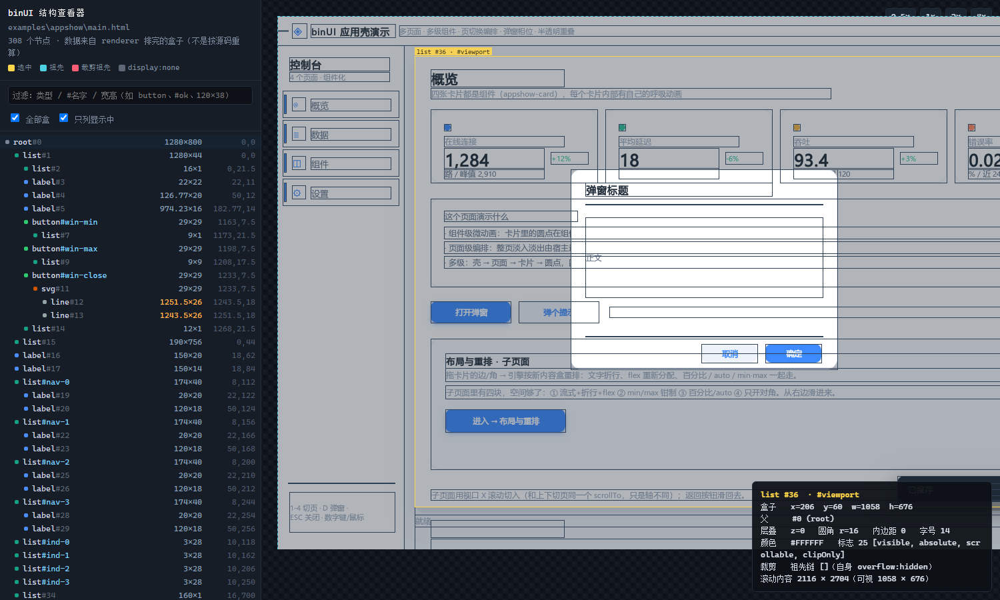

# 14 - 写起来像网页、却看不了网页：浏览器预览与结构查看的缺口

**状态**：**P0 原型已跑通、P1 已落地**（`tools/binui_preview.py`、`draw_bench --dump-nodes` + `tools/binui_nodes.py`），P2 未做，待定优先级。
**类型**：开发者体验（DX） · **严重度**：中高（不是正确性问题，但决定"写 UI 这件事顺不顺"）
**影响面**：所有写 `.bum.html` / `main.html` 的人；与运行时零关系（镜像页/查看器都不参与渲染）。

> 一句话：**源码是 binUI 的编译期布局语言，不是 HTML，浏览器直接打开必然散架**；
> 但"写完立刻在浏览器里看结构、看盒子、看大致布局"是可达的，分三层做：
> ① 镜像页（P0，已原型）② 结构 JSON + 布局叠层（P1）③ wasm 真渲染（P2）。

---

## 1. 现象与根因（为什么浏览器打开是"乱成一团"）

| 现象 | 根因 |
|---|---|
| 组件全堆在左上角、没有位置 | `x="20" y="64" w="120"` 是 binUI 的属性，浏览器不认识；位置是**编译期**从 `<use>` 展开成绝对坐标的 |
| 按钮/卡片没有尺寸、只剩文字 | `style="width:{{w=132}}"` 里 `{{…}}` 是模板语法，浏览器当非法 CSS 值丢掉整条声明 |
| 宽高/圆角/字号全部失效 | binUI 的**无单位长度按 px** 解释；CSS 里除 `0` 外必须带单位 |
| 组件内容根本没展开 | `<use src>` 是 binUI 的编译期实例化，浏览器不认这个标签 |
| 样式部分生效、部分不生效 | binUI 只实现 CSS 子集（flex 子集、部分伪类/滤镜），且级联是编译期拍平的 |

这不是"缺个开关"，是两条路线：**binUI 把 HTML 当写布局的语法，浏览器把 HTML 当文档渲染**。

## 2. 需要的是三件不同的事

| # | 想看到什么 | 能做到的技术 | 状态 |
|---|---|---|---|
| ① | **大致视觉**：这块在不在、什么颜色、差不多多大 | 源码 → 浏览器镜像页（展开组件、替参数、补单位） | **P0 原型已跑通** |
| ② | **结构与盒子**：节点树、父子、每个盒的 x/y/w/h、谁裁谁 | 真实布局引擎导出 JSON + 单页 viewer（树 + 叠层高亮） | **P1 已落地**（`draw_bench --dump-nodes` + `tools/binui_nodes.py`） |
| ③ | **像素级**：真渲染、真字体、真的 AA | 把布局+光栅编成 wasm，在浏览器里跑 canvas | 未做，中期目标 |

## 3. 三条路

### P0 镜像页（已原型，`tools/binui_preview.py`）

做的事只有四件，全在"改写源码"这一层，不碰编译器：

1. `<use src=…>` **递归内联**（按 src 相对该文件解析，与编译器同一规则；宿主子元素落进根容器）；
2. `{{name}}` / `{{name=默认}}` 用 `<use>` 上的同名属性替换；
3. 无单位长度补 `px`（只对长度属性：`width/height/left/top/padding/margin/border-radius/font-size/gap…`），
   `width:content` → `max-content`；`<app_window width height bg>` 折进 `style`；
4. 自定义标签映射成 `<div data-binui="…">`（结构还在，浏览器能 lay out）。

实测（`components/preview.html`）：

| | 结果 |
|---|---|
| binUI 真渲染（`bin2d_shot`） | 见 `docs/img/std-components.png`，像素权威 |
| 浏览器镜像（Edge headless 截图） | `out/preview/browser.png`，结构/位置/配色对得上，**文字换行与图标有差异** |

**局限（必须写在显眼处）**：字体度量不同 → 文字宽度/换行不同；字形图标（1px 条 / 方框 / ✕）在镜像里可能丢；
绝对定位的组件内元素（对话框按钮）可能跑到盒外；`overflow` 裁剪不模拟。**它不是像素权威，别拿它对像素。**

产出放在 `out/preview/`（已被 `.gitignore` 覆盖），不落源码树。

**组件独立视图（原型已有）**：`--stage` 模式把单个组件放在棋盘底板中央，带 `1x/2x/4x/8x`
缩放、盒边界虚线、尺寸读数（`?zoom=4` 写 URL），键盘 `+ - 0`。它回答"这个组件的弧/线/阴影
对不对"，是 `binui dev`（[15](15-valid-html-language.md) M2）里那条 `/__binui/component/…`
路由的原型。

### P1 结构导出 + 布局叠层（**已落地，2026-11-21**）

编译/布局之后，渲染器手里已经有：节点表（id / 父 / class / 名称 / 标志位）、计算后的盒
（x/y/w/h）、裁剪祖先链、滚动内容高。现在把这份**运行时真布局**导出来，配一个单页 viewer：

```sh
# 1) 导出（读的是 renderer 排完之后的 getNodes()，不重算任何布局）
build-mingw\bin\draw_bench.exe examples\buttonshow\main.html --dump-nodes out\nodes\buttonshow.json
# 2) 出图（像素仍是 bin2d_shot 权威）
build-mingw\bin\bin2d_shot.exe examples\buttonshow\main.html out\nodes\buttonshow.png
# 3) 合成自包含 HTML（JSON 与 PNG 内联成 base64，file:// 直接开，不用起服务）
python tools\binui_nodes.py out\nodes\buttonshow.json out\nodes\buttonshow.png -o out\nodes\buttonshow.html
```

viewer 提供的东西：

- 左：树（缩进 + 类型 + `#名字` 或 `#id` + 盒尺寸 + 坐标），可按类型/名字/宽高过滤；
- 右：`bin2d_shot` 的 PNG 上叠每个节点的盒框，点树高亮盒、悬停显示计算值、点图命中最深节点；
- 颜色约定：黄=选中、青=祖先、红=裁剪祖先、灰虚线=display:none；
- 附带：`scrollable` 节点显示「滚动内容 2116 × 2704（可视 1058 × 676）」这类读数，
  这正是"这个盒子为什么不在那"的答案；
- 深链 `#sel=36&all=1` 可分享"看这个盒子"的现场。





数据来源的一个具体例子（`examples/appshow`，308 节点）：`#36` 视口 `y=60 h=676` 而内容高
`2704`，所以 `#110` 这类节点 `y=1496` 在窗口外；`x=1288` 往后的节点属于右侧子页面 ——
这些在浏览器镜像页里看不出来，在结构查看器里是明摆着的数字。

这条最值得做的理由仍然成立：**它回答的是"布局对不对"，而不是"看起来像不像"**，且数据来自
真实引擎，不会出现"浏览器里对、binUI 里错"。实现约 150 行导出 + 1 个自包含 viewer
（`--dump-nodes` 在 `tools/draw_bench.cpp`，viewer 生成器是 `tools/binui_nodes.py`）。

### P2 wasm 真渲染（中期）

把编译 + 布局 + bin2d 的 CPU 光栅编进 wasm，浏览器里 `fetch 源码 → 编 → 画到 canvas`，
加一层热重载（文件变动重编）。FreeType/HarfBuzz 都有 wasm 构建先例，难点是**中文字体体积**
（几 MB）与文件读取权限。这条做完才是真正的"写网页那样"：改一行、刷新、看到真实渲染。
工作量 2–4 周，不建议在 P1 之前开工。

## 4. 不建议为了浏览器改语法

有第三条路：把源码改成**合法 HTML 子集**（`{{}}` → `data-*`、无单位 → 强制 `px`、
`<use>` → `<binui-use>`、绝对坐标 → 标准 CSS）。收益是"浏览器里能凑合看"，代价是：

- 所有存量布局要迁移（`examples/`、`components/`、`docs/mockups/`）；
- 编译器的解析/参数替换/组件内联全部要重写口径；
- 而且**仍然不是像素级预览**（字体/AA 还是不一样），最终还是要 P2。

镜像生成器能拿到 90% 的收益、0 迁移成本，所以先做它。

## 5. 建议顺序

| 轮次 | 做什么 | 验收 |
|---|---|---|
| 1 | P0 镜像生成器收成正式工具（`binui_preview`，输出到 `out/preview/`） | `components/preview.html` 与 `examples/*` 各一组截图，肉眼可读 |
| 2 | ~~P1 结构导出 + 布局叠层 viewer~~ **已完成** | 能回答"这个盒子为什么不在那" —— `draw_bench --dump-nodes` + `tools/binui_nodes.py` |
| 3 | 热重载（P0/P1 都受益：改源码 → 浏览器自动刷新） | 保存即刷新，无需重跑命令 |
| 4 | P2 wasm 真渲染 | 浏览器里像素与 `bin2d_shot` 一致（同机同字体） |

## 6. 原型怎么用

```sh
# 生成镜像页（浏览器可直接打开）
python tools/binui_preview.py components/preview.html out/preview/components-preview.html

# 对照真实渲染
build-mingw\bin\bin2d_shot.exe components/preview.html out/preview/real.png
```

镜像页底部有一条常驻提示（"近似布局；像素请用 bin2d_shot"），提醒看的人别拿它当基准。
