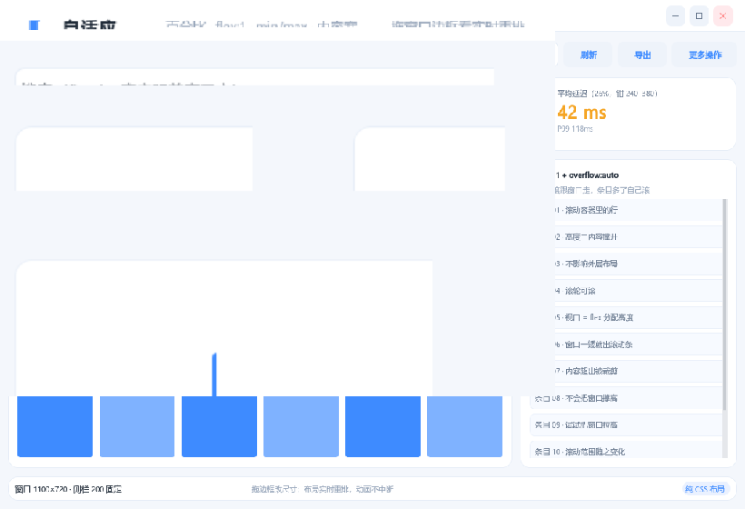

# 启动耗时：实测分段与量法

"双击后要等一会才出画面"这类问题，**先量，再改**。这份文档记录 v0.18.0 起的测量工具、
本机实测数字、以及一条踩过的坑（用错工具量出来的数字假到能带偏结论）。

## 1. 怎么量

三个环境变量，互相独立：

| 变量 | 作用 |
|---|---|
| `BINUI_STARTUP=1` | 打开分段探针：每个里程碑往 stderr 打一行 `[startup] <阶段> <累计 ms>` |
| `BINUI_STARTUP_FILE=<path>` | 探针改写到这个文件（**推荐**，见 §4 的坑）。设了它就等于同时打开了探针 |
| `BINUI_FRAME_EXIT=<n>` | 画满 n 帧后**正常退出**（静态页面本来只画 1 帧，所以要 n 帧时外壳会强制重绘），自动化量测不必外部强杀 |
| `BINUI_PERF=1` | 已有的帧统计：`绘制 / 呈现 / 间隔` 的 avg·max；配合 `BINUI_FRAME_EXIT` 短跑也会打印 |

`BINUI_BOOT_EXIT=1` 是给示例用的：走到事件循环前就返回，只量"启动路径"（不要首帧）。

示例（PowerShell，量 `examples/flexshow`）：

```powershell
$env:BINUI_STARTUP_FILE='D:\projects\binUI\build-mingw\tmp\startup.log'
$env:BINUI_FRAME_EXIT='1'
$sw=[System.Diagnostics.Stopwatch]::StartNew()
$p=[System.Diagnostics.Process]::Start('D:\projects\binUI\build-mingw\bin\examples\flexshow.exe')
$p.WaitForExit(); $sw.Elapsed.TotalMilliseconds
Get-Content build-mingw\tmp\startup.log
```

## 2. 本机实测（flexshow，1100×720，RTX 4060 Ti / 120Hz / GL 后端）

累计耗时（从 `main()` 起算），三次运行一致：

| 里程碑 | 累计 ms | 本段 ms | 归属 |
|---|---|---|---|
| `compile + load layout` | 3.5 | 3.5 | **binUI**（HTML→布局） |
| `UiApp ctor` | 3.7 | 0.2 | **binUI** |
| `open: DPI+class` | 4.0 | 0.3 | 系统（DPI/RegisterClass） |
| `open: SPI_GETWORKAREA` | 4.6 | 0.6 | 系统 |
| `open: CreateWindowEx` | 205 | **200** | 系统（**一次性**，见 §3） |
| `GL context (WGL 3.3)` | +145 | **145** | 显卡驱动（一次性） |
| `GL shaders` | +15 | 15 | 驱动编译 GLSL |
| `GL state+framebuffer` | +2 | 2 | binUI |
| `font atlas initFonts` | +1 | 1 | binUI（FreeType 懒加载，不是瓶颈） |
| `open done (window visible)` | 392 | 6 | 系统（前台化/焦点） |
| `frame1: draw_ (verts)` | +31 | **31** | **binUI**（布局遍历 + 顶点上传） |
| `frame1: present done` | **662** | **227** | 驱动/DWM（一次性，见 §3） |

**结论：到第一帧 662 ms，其中 binUI 自己的代码只占 ~35 ms（5%）**，剩下 95% 是窗口创建、
GL 上下文、第一次 SwapBuffers 三项一次性系统/驱动开销。连续帧稳态是 `绘制 0.58 ms /
呈现 11.7 ms`（120Hz + 垂直同步），所以"启动慢"和"用起来卡"是两件互不相干的事。

退出也一样：`BINUI_FRAME_EXIT=1` 的进程墙钟 660 ms 画完，**墙钟还要再多 220~265 ms**
才是进程消失 —— 那是 `wglDeleteContext` + 驱动卸载 + CRT 退出，不是画面没画完。

## 3. 那三项一次性开销能不能砍？——基本不能

用 [tools/win_create_time.cpp](../tools/win_create_time.cpp) 做最小对照实验（一个裸
`CreateWindowExW`，不涉及 binUI）：

```
x86_64-w64-mingw32-g++ -O2 -static-libgcc -static-libstdc++ \
    -o build-mingw/tmp/win_create_time.exe tools/win_create_time.cpp -luser32 -lgdi32
./build-mingw/tmp/win_create_time.exe
```

| 实验 | CreateWindowEx 耗时 |
|---|---|
| 进程里**第一个**窗口（裸类，无 CS_OWNDC） | **156 ms** |
| 第二个窗口（带 CS_OWNDC） | 23 ms |
| 第二个窗口（不 WS_VISIBLE） | 2.9 ms |
| 标准 WS_OVERLAPPEDWINDOW | 15 ms |
| **再一个** popup+visible | 19 ms |

即"第一个窗口 150 ms"是**进程一次性**成本（user32/DWM/主题第一次初始化），和 binUI 的
样式、`CS_OWNDC`、`WS_VISIBLE` 都无关。GL 上下文 145 ms、第一次 SwapBuffers 227 ms 同理
（`[perf]` 里能看到 `呈现 max=227.18` 而 `avg=11.67` —— 只有第一帧异常）。

所以这里**没有可优化项**：剩下的唯一"优化"是把一次性成本挪个位置（比如先隐藏建窗、
GL 就绪后再显示），总时长不变，只是把"白窗等待"换成"晚 500 ms 出窗"，体验更差。

真要再快，方向在别处（都不属于当前范围）：把 GL 上下文与首帧放在独立线程预热、
或者干脆不用 GL 给静态页（GDI 后端首帧只要几毫秒）。

## 4. 坑：**别用 PowerShell 的 `-RedirectStandardError` 量启动**

同一份二进制、同一行代码，只改重定向方式：

| 方式 | `UiApp ctor` 里程碑读数 |
|---|---|
| 控制台直连（`& exe`） | **3.5 ms** |
| `Start-Process -RedirectStandardError file` | **1207 ms** |

差别不在程序，在**每次 `fflush(stderr)`**：子进程 stderr 被 PowerShell 重定向到文件后，
这台机器上每次 flush 要 ~1.1 s（写穿透 + 杀软逐次扫描），三段日志就凭空多出 3 秒多。
所以：

* 量启动**必须**用 `BINUI_STARTUP_FILE`（探针自己 `fopen` 追加写，一次 ~0.1 ms）；
* 想用管道/文件重定向收集 stderr 时，**任何**带 `fflush` 的诊断都会失真 —— 这条对
  `[perf]`、`BINUI_GL_VERTS`、`BINUI_BLUR_TRACE` 同样成立。

探针本身也做了两件事保证读数可信：时间戳在写日志**之前**取（日志开销不计入本段）；
`BINUI_STARTUP_FILE` 路径用 `fopen(..., "ab") + fwrite + fclose`，不依赖 CRT 缓冲。

## 5. 拖边框 resize：`BINUI_RESIZE_BENCH` 与 `make resize-bench`

"启动慢"和"拖边框卡"是两件事，后者每到一次 `WM_SIZE` 就要**重排整棵树 + 后端重建
交换链/后备缓冲**。三个后端共用同一份窗口外壳（`binui_app.h`），所以压测也放在外壳里：

```powershell
$env:BINUI_RESIZE_BENCH='60'          # 每帧把窗口宽度抖 ±40px，画满 60 帧后打印并退出
.\build-mingw\bin\examples\flexshow_vk.exe
# 或者一次跑三个后端并检查报错：make resize-bench
```

输出两段耗时（**分开算**，否则看不出是布局慢还是后端慢）：

```
[resize-bench] 60 次 resize（每帧 ±40px，1100x720 基准）
[resize-bench]   布局(宿主回调) avg=0.03 max=0.04 ms
[resize-bench]   后端 gfx.resize avg=4.68 max=17.31 ms
```

本机实测（1100×720 → ±40px，60 次）：

| 后端 | `gfx.resize` avg | max | 说明 |
|---|---|---|---|
| GDI/GL | 0.46 ms | 0.76 | 只重建离屏 FBO |
| Vulkan | **4.68 ms** | 17.31 | 重建交换链（v0.19.0 之前是 **26.6 ms**） |
| D3D11 | 0.31 ms | 0.48 | ResizeBuffers + 离屏（v0.19.0 之前是"瞬间失败"） |

### 5.1 v0.19.0 修掉的三个坑（都是量出来才看见的）

1. **D3D11 的 `ResizeBuffers` 每次都失败**（`hr=0x887A0001` = `DXGI_ERROR_INVALID_CALL`）：
   调用前我们还持有着后备缓冲的 RTV、并且它还绑在管线上。失败是**瞬间返回**的，所以
   "耗时 0.09 ms"看起来漂亮，实际交换链永远停在旧尺寸 —— 画面被系统拉伸/裁切。
   修法：先 `OMSetRenderTargets(0,…)` + 释放 RTV + `Flush()`，再 ResizeBuffers。
2. **D3D11 的视口在 resize 后没换**（`RSSetViewports` 只在 `createState()` 里设过一次）：
   窗口变小后视口还是旧尺寸，NDC 被映射到旧大小的区域，画面整体放大 `1100/820≈1.34`
   倍并裁掉右边和下边 —— 看起来像"内容没重排"，其实布局是对的、视口是错的，而且
   **GDI 与 Vulkan 后端都没有这个毛病**（它们各自在 resize 里换视口），所以只比
   `pixels-vk` 是发现不了的。修法：resize 里换视口 + `beginFrame` 每帧再对一次。
3. **Vulkan 每次 resize 26 ms**：`createSwapchain()` 里"先销毁再新建"（`oldSwapchain =
   VK_NULL_HANDLE`），外加每次都重新枚举 surface caps / formats / presentModes ——
   单独量出来：**查询 3.3~4.4 ms + CreateSwapchain 3~5 ms + 销毁旧链 ~4 ms**。
   修法三件：
   * `ci.oldSwapchain = 旧链`（Vulkan 推荐的 resize 路径，驱动能复用底层资源），
     创建成功后再销毁旧链（失败路径用 RAII 保证也销毁，不漏一个 swapchain）；
   * surface 能力**缓存**（caps/formats/presentModes 在一个 surface 上不变）；
   * 交换链尺寸改成"要的窗口尺寸"而不是缓存里的 `caps.currentExtent` —— 用缓存值会
     按旧尺寸建、随后 present 前发现不一致又建一次，一帧里建两条链（踩过）。
   顺带把 present 前那次**每帧**的 `vkGetPhysicalDeviceSurfaceCapabilitiesKHR`（实测
   ~0.7 ms，占 120Hz 帧预算的 8%）换成先比 `GetClientRect`，只在真不一致时才去查。

验证：把三个后端的窗口都改成 820×560 后截图互比，`pixel_diff` 结果
VK↔GL 80 px（只有一行 1 px 的滚动条位置）、VK↔D3D 80 px —— 三者完全一致。

| 修前（D3D11） | 修后（D3D11） |
|---|---|
|  |  |

修前那张就是上一条 bug 的现场：视口还是 1100×720，布局其实已经重排成 820×560，但被
放大 1.34 倍后裁掉了右/下（状态栏整个看不见）。修后的 D3D11 与 Vulkan 逐像素一致
（[VK 截图](img/resize-820-vk.png)、[GL 截图](img/resize-820-gl.png)）。

### 5.2 v0.19.1：VK 把窗口拉到"铺满显示器"后画面停住（GDI 贴屏对 flipping 窗口无效）

现象：VK 窗口 resize 到刚好盖住整块显示器（本机 2560×1440）后，画面**停在上一帧**、
新增区域全黑，状态栏尺寸也不更新；而同一尺寸 GL 与 D3D11 都正常。
0.19.0 的结论只覆盖到 820×560 与 2500×1350（都没到"铺满"），所以漏掉了。

根因不是尺寸没传下去 —— 打点显示整条链都是对的：

```
[app][resize] apply 2560x1440（gfx ready=1）
[fx][resize]  setSize(2560,1440) -> root=2560x1440
[vk][targets] 重建 2560x1440（swap 2560x1440）
[vk][gdi]     读回 2560x1440
[vk][blit]    2560x1440 ret=1440（全部扫描线成功）客户区=2560x1440
```

也就是说**画对了、读回来了、也 blit 成功了，屏幕上就是不更新**。原因是 Windows 上
VK 的 WSI 一旦为这个窗口建过交换链，它就成了 flipping 窗口，DWM 只合成**交换链里的图**，
GDI 往窗口 DC 画的东西根本不上屏。`clientCoversMonitor()` 那条守卫恰恰把 VK 从交换链
踢到了"读回 + GDI 贴屏"，于是画得再对也看不见。

修法：**有交换链时就不用 GDI 贴屏**（`gdiPath` 去掉 `coversMonitor` 条件，
`presentViaGdi()` 在有交换链且非远程/非透明时直接走交换链）。远程会话仍然走读回
（那条是虚拟显示器上交换链会停帧的实测结论），透明窗本来就没有交换链。

> 这条经验适用于所有"flipping 窗口 + GDI 贴屏"的组合：判断标准不是"哪个后端"，
> 而是**这个窗口当前是不是由交换链在呈现**。GL 没有交换链，所以它的 GDI 路径一直是好的，
> 这也正是"只有 VK 出问题"的原因。


