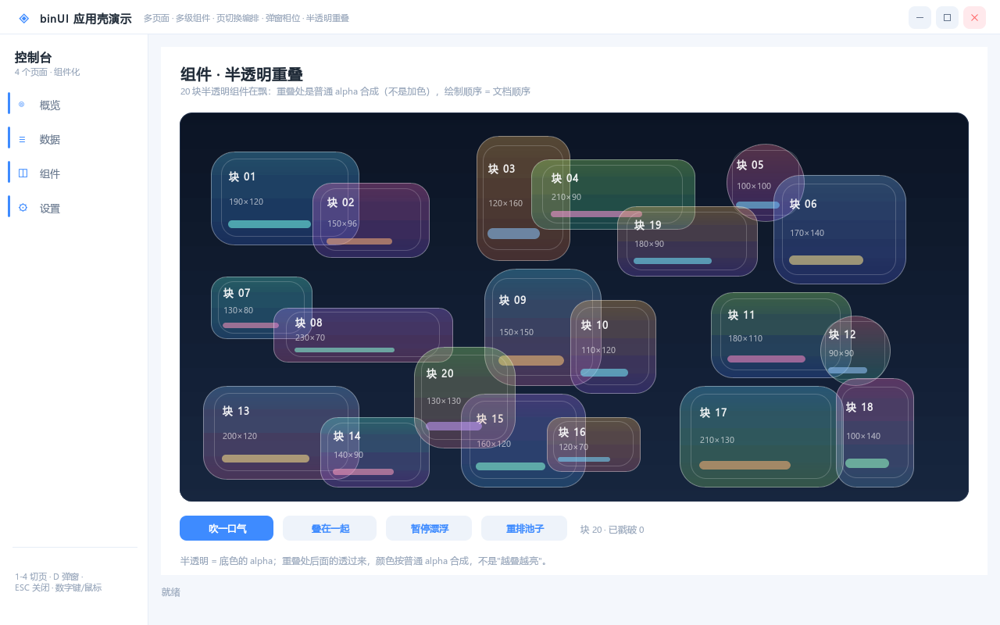
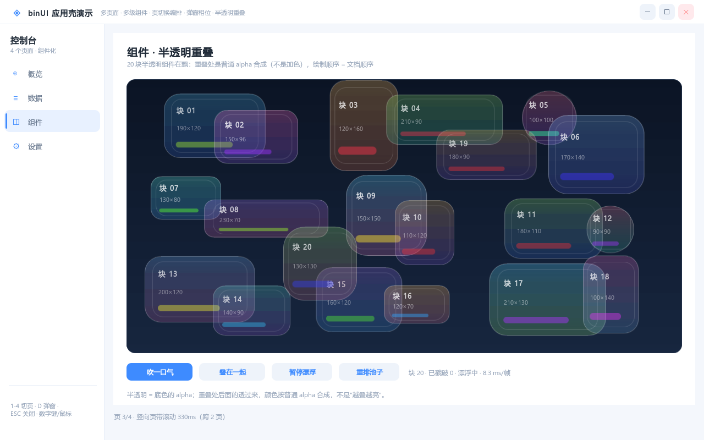
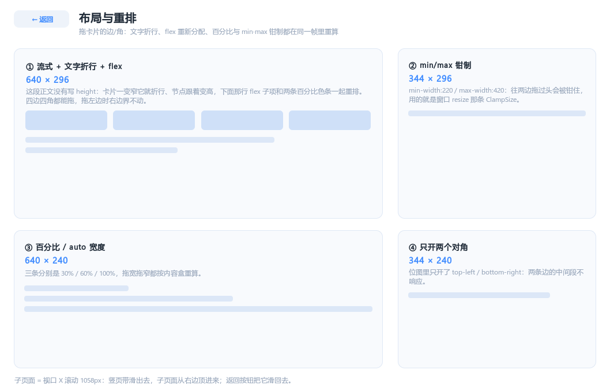

# 多页面 · 多组件 · 编排（appshow）

> `examples/appshow` 是这个主题的活例子。这份文档解释它**为什么这么写**，
> 以及在当前引擎能力下，"多个页面/组件一起动"到底能做到什么程度。

## 1. 一句话原则

**微动画写在组件里，进出场写在容器/宿主里，先后顺序由宿主记账。**

引擎侧只有"单个节点的属性在时间轴上插值"这一种原语（`@keyframes` 关键帧、
`transition` 过渡、运行时 `setStyleFloat/setStyleColor`），**没有跨节点编排**：
没有动画组、没有时间轴、没有完成事件。所以"配合"只能靠**职责切分 + 相位差 + 宿主的
时间片**三件事拼出来。

## 2. 三层职责

| 层 | 该写什么 | 不该写什么 | appshow 里的位置 |
|---|---|---|---|
| **组件**（`.bum.html`） | 自己被操作时的反馈：hover/press/focus 的 `transition`；常驻的呼吸/脉冲 `@keyframes` | 进出场、页面级时序、业务状态 | `appshow-card` 的 `as-breathe`、`appshow-navitem` 的 `:hover` |
| **容器/壳**（`main.html`） | 页面容器、遮罩、弹窗、提示条的**几何与层级**；`transition` 声明（让宿主能驱动） | 页面切换的先后顺序（它不知道"谁在切"） | `#page-0..3`、`#veil`、`#toast`、`.page`/`.row` 的样式 |
| **宿主**（`main.cpp`） | 状态机：切页/开窗/交错/自动关闭；逐帧 tween；把结果写回引擎 | 具体像素、具体元素外观 | `Shell::goPage / openDialog / toast / replayRows / tickFades` |

## 3. 当前引擎的四条硬约束（决定了实现手法）

1. **`opacity` / `scale` 是节点自身属性，不向后代继承。**
   所以"整页淡出"必须由宿主对**子树里每个节点**设值。`appshow` 启动时把每页子树
   `subtree(pageId)` 拍平成数组，tween 时一次性 `setStyleFloat(id, ANIM_OPACITY, v)`。
   代价：一页几十个节点就是几十次调用 + 几十个失效矩形；换来的是不依赖新功能。
   （0.12.8 起 `opacity` 也作用于**渐变底与边框**；之前只影响单色底/文字/图片，
   淡出渐变卡片或描边圆环时底和边是不动的。）
2. **没有"动画完成事件"。**
   所以"旧页退完再进场"不能等回调，只能**宿主自己记时间**（`sh.now` 与 `Fade::start/dur`
   对齐）。这也是为什么 `appshow` 里有自己的 `Fade` 调度器。
3. **一个节点只有一条 `animation`。**
   想让一个元素同时滑动 + 淡入 + 旋转，必须合并成**同一条 `@keyframes`**，让各属性在
   各自的关键帧上插值（`animshow` 的 `combo`/`compound` 就是这么写的）。
4. **页带要放在 `overflow:hidden` 的视口里**（0.12.6）。
   四页排成 `top = i*页高` 的竖带，视口高度 = 一页高、`overflow:hidden`（只裁剪、
   不出滚动条、不响应滚轮），切页就是 `scrollTo(0, i*页高)`。
   `overflow:hidden` 的语义（0.12.7 起彻底成立）：**可编程滚动、不出滚动条、不响应滚轮**、
   也不预留 gutter；要"能拖能滚"就写 `overflow:auto`。
   ⚠ 这类容器在**名称表里可能没有名字**（`findNodeByName("viewport")` 返回 0），
   宿主定位它要靠"第 1 页的 `parentId`"，别指望 id 名。
   ⚠ 旧思路"给子树每个节点设同一个 translateY"只在视觉上成立，命中测试不认——已废弃。
   `translate` 是节点自身属性、不继承，所以"整页推走"= 对子树里**每个**节点设同一个 dy；
   元素会飞出内容区，盖到标题栏/侧栏上。做法是在页面外面包一层
   `overflow:hidden` 的视口容器（裁剪链自动生效，见 appshow 的 `#viewport`），
   并且把边框/圆角放在视口上、页面本身用白底方块 —— 否则滑动时能看到 4 个角缺口。
5. **同一个动画值只能有一个出口**（0.12.5 修）。
   绘制/命中读的是 `drawState()`，而位移还有一条 `drawOffsetX/Y()` —— 两处各自维护
   "从哪取平移"的逻辑，加单轴通道时只改了一处，于是 `drawOffsetY` 有值、绘制读的是 0，
   表现就是**页面没有动画、只在结束时刻跳一下**。现在 `drawState()` 的三路来源与
   `drawOffsetX/Y` 完全一致；自检也改成读 `drawState()`（和绘制同源），这类"两套口径"
   才不会再漏。
6. **`press` / `release` 的命中口径必须一致**（0.12.3 修）。
   `press` 用 `hitTestEx(allowStyled=true)`（"声明了状态样式的普通元素"也算可点），
   而 `release` 早先用的是严格 `hitTest`（只认 `BINUI_INTERACTIVE`）——
   于是"只写了 `:hover` 的普通 div"按下去有视觉反馈、松手却永远不产生 CLICK，
   点击被**静默吞掉**。现在两处同口径，且 `allowStyled` 接受任意一种状态样式
   （只写 `:hover` 也算）。
7. **`@keyframes` 是全局命名空间。**
   `<use src>` 是编译期内联到同一个文档、`kfGroups` 按名字全局匹配且**先到先用**，
   两个组件都定义 `@keyframes fade` 会静默串味。约定：`@keyframes <组件名>-<用途>`。

另外两条容易被坑的：

- **`drawOpacity` 先看动画结果、后看 `floatTargets`**：给一个"自己正在跑 opacity 关键帧"
  的节点设 `ANIM_OPACITY` 是**无效**的。所以常驻微动画不要动 `opacity`
  （`appshow-card` 的呼吸只动 `scale`，就是为了让宿主的淡出始终有效）。
- **CSS 规则覆盖内联 style**（本引擎的既定口径），所以组件参数尽量走 `{{name=默认}}`
  而不是在调用处写内联 style 去盖。

## 4. 编排模式：相位差 + 交错

`appshow` 里所有"配合"都是同一条时间轴上的**相位差**：

```
切页（竖页带滚动：像浏览器里点锚点跳页）：
        四页在视口里排成一条 4×676 的竖页带，切页 = 把视口滚到第 N 页的偏移
        滚动时长 = 0.16 + 0.085 × 跨了几页（上限 0.55s），ease-out
        数据页 6 行                       [滚完 + i*45ms ─── +200ms]

  这是"能看清中间隔了几页"的做法：一次从第 1 页跳到第 4 页，中间两页会从眼前过去。
  **必须用引擎的滚动状态**（`renderer.scrollTo(viewport, 0, y)`），不要用逐节点
  `translateY` 模拟：
    · 滚动偏移参与命中测试与裁剪，`translateY` 不参与 —— 模拟滚动的结果是"画面对了、
      点击错位"（点到的是布局位置上的那一页）；
    · 滚动容器的子节点偏移由遍历自己累加，宿主每帧只需要一个 `scrollTo`；
    · 可打断：滚到一半再点一次，从当前位置接着滚（浏览器行为）。

弹窗：  遮罩 opacity 0→1  [0ms ─── 160ms]
        面板（整棵子树）   [40ms ───── 220ms]                  ← 面板晚 40ms

提示条： 0→1 [0..150ms] → 停 1.7s → 1→0 [..+250ms] → 隐藏
```

`Fade::hold` 是这套机制的关键细节：一轮交错里，**还没轮到的行要保持 0**，
否则会被整页淡入提前点亮（`appshow` 第一版就踩了，日志里表现为后面的行先变成 1.00）。

## 5. 被动查询：编排的状态从哪来

编排要读状态，读状态的方式就是**查询**，不是事件：

- `renderer.hoveredNode()` —— 悬停节点（没有"悬停事件"，移动时直接查）
- `renderer.hitTest / hitTestEx` —— 坐标 → 节点
- `renderer.getNodes()` / `findNodeByName` —— 节点表（`NodeInfo` 带 `parentId`，
  所以能沿父链把"点到了文字"冒泡回"真正的按钮"）
- `renderer.drawOpacity / drawOffsetX` —— 当前动画值（自检模式用它打印）

`appshow` 的底部状态栏就是"被动查询的读数"：页号、节点总数、悬停节点的 id/类型/文本。
页面里的「查询悬停节点」按钮把命中节点的 id/类型/矩形/父节点/文本写进弹窗——整条链路
（命中 → 查询 → 渲染）都不依赖任何事件。

## 6. 自检：没有窗口抓图也能验编排

```bash
BINUI_APPSHOW_AUTO=1 build-mingw/bin/examples/appshow.exe
```

按脚本走一遍切页/弹窗/交错，并打印每步的**实际不透明度**：

```
[demo] nav-1       t=0.31 滚动=0（看第1页）veil=0.00 rows=0.00 0.00 0.00 0.00 0.00 0.00
[demo] push-40%    t=0.44 滚动=536（看第2页）veil=0.00 rows=0.00 0.00 0.00 0.00 0.00 0.00
[demo] push-end    t=0.62 滚动=676（看第2页）veil=0.00 rows=0.45 0.07 0.00 ...  ← 滚完才开始交错
[demo] dlg-in      t=2.31 滚动=2028（看第4页）veil=1.00 rows=1.00 ...
[demo] bub-pop-mid t=4.52 被戳破的 #19：popT=0.12 scale=1.47 op=0.37
[demo] bub-respawn t=5.10 被戳破的 #19：位置=(377,2066) popT=-1.00 scale=1.03 op=0.80 → 已重生
```

这是最便宜的回归方式：编排逻辑错位会立刻显示成不可能的不透明度组合。

## 7. 缺什么才叫"真正配合"

按性价比排序，前两条是这类需求的通用解：

1. **单节点重播**：`restartAnimation(nodeId)`。现在只有全量的 `restartAnimations()`，
   改一个角标就得让整屏动画重来。
2. **动画完成事件**：`onAnimationEnd(nodeId, name)`。有了它，宿主不用猜时长，
   `Fade::start/dur` 那套手工对表可以删掉。
3. **一个节点多条 animation**（逗号列表）：把"滑入 + 淡入 + 缩放"拆开调。
4. **交错原语**：编译期 `--i` 变量或运行时 `setStagger(base, step)`，
   省掉"每行一条 tween"的样板。
5. ~~`setStyleFloat` 的 `ANIM_TRANSLATE` 只能让 x==y~~ → 0.12.3 已加 `ANIM_TRANSLATE_X/Y`
   两个独立通道（过渡与运行时驱动都支持），"只上下滑 26px"现在成立。

## 8. 约定（建议写进团队规范）

- 组件只写"自己被操作时"的动画，命名带组件前缀；
- 组件**不写进出场**，进出场只由容器/宿主决定 → 组件才能被任意容器复用；
- "多个元素对同一事件反应"不让子组件各自监听，**父容器统一切 class / 统一起 tween**；
- 跨页面、跨窗口的时序**一律宿主记账**，别在 CSS 里堆超长 delay 假装编排；
- 页面切换期间要么屏蔽点击、要么让新旧两页的命中区不重叠（`appshow` 在模态期只放行
  弹窗内与遮罩的点击）。

## 9. 半透明组件重叠：把“宿主驱动一切”推到极端

第 3 页的 `#pool` 是这一页的全部内容：20 块半透明组件，每块是
`appshow-bubble.bum.html`（5 个普通 div 图层）。它要看的不是“像不像泡泡”，而是
**两个半透明组件叠在一起时颜色怎么合**：alpha 0.3 的两块叠起来不是“更亮”，而是
“后面的透过来 70%”；叠的顺序 = 文档顺序（后声明的压在上面）。

**组件只画外观，一个字节的状态都不存。**

| 组件里有什么 | 宿主里有什么 |
|---|---|
| 半透明双色渐变、1px 边光、内圈细框、标题/副标题、底部色条 | 位置 / 速度 / 相位 / 不透明度 / 色相 / 爆开进度 / 重生 |
| `<use>` 上传的 11 个参数（宽高、圆角、两色、边光、内框、色条、两行文字） | 每帧 `translateX/Y + scale + opacity` × 5 层 + 色条的 `setStyleColor` |

为什么拆成 5 层而不是一张图：每层**各走各的通道**（爆开只动 `scale`、爆开的同时淡出、
色条在色相环上漂）。合到一张图里就只能整体动，“半透明”和“跟着动”就没法分开调。
代价是每块每帧 ~21 次 `setStyleFloat/setStyleColor`，20 块 ≈ 420 次 ——
这就是“节点级属性 + 不继承”在当前引擎下的真实成本。

**这里保留了“呼吸”（连续改 `scale`）**：填充边缘 0.16.3 起是抗锯齿的，尺寸连续变化也能
跟着连续滑（0.16.2 曾为了绕开硬边抖动而关掉它，同一个坑随填充 AA 一起解决了）。


四个必须知道的坑（都写进代码注释了）：

1. **命中在宿主算**。引擎 `hitTest` 用**布局**矩形，`drawState` 里的位移不参与，
   所以被 translate 挪走的块点不到。宿主按“当前矩形”自己算，顺序与绘制一致
   （后画的在上）。
2. **滚动期间别推进**。宿主算的脏矩形是“滚定后”的窗口坐标，而滚动中引擎按滚动
   偏移自己挪子节点 —— 两者错位会留下残影。所以只在“本页 && 不在滚动”时推进。
3. **暂停是停宿主时钟，不是引擎**。暂停后位置/色相原地冻住，继续时从原处接着走，
   没有跳变；但**已经戳破的块仍然演完**（否则会僵在 `popT=0` 永不重生）。
4. **两套坐标要显式换算**。组件状态用的是**布局**坐标（页面在竖页带里的那一段，
   截图里 `块 01` 的布局 y 是 1546），而脏矩形和点击是**屏幕**坐标（滚到第 3 页后
   y=194）。宿主里就一处 `ScreenY()` 干这件事；漏了它的症状是"窗口里啥也没有、
   每帧整窗重绘、点不中"。
   ⚠ 引擎这一侧也有同一个坑，而且更致命：**滚动容器里的裁剪容器**（比如 `#pool`）
   计算裁剪矩形时用了布局坐标，子节点会被整片裁掉。0.12.10 修的就是它
   （遍历的视口矩形 / 祖先裁剪链 / `hitTestEx` 三处都要减 `offX/offY`）。



真实窗口里抓的一张（同一页，验证嵌套裁剪容器在滚动页带里没有被裁掉）：



点「叠在一起」之后（真实窗口截图，20 块叠在池心，交叠区就是 alpha 合成的结果）：


想看“最重的重叠”，点「叠在一起」：20 块全挪到池子中心，交叠区就是 alpha 合成的
结果；再点「重排池子」散开。这一版还顺手逼出四个渲染缺陷（见 `CHANGELOG.md` 0.12.8）：
半透明渐变的横向条纹（条带 0.5px 重叠 + alpha 混合）、`opacity` 不管渐变底/边框、
圆角模板 LRU 帧内删纹理导致整块纯色、GL/D3D11 批次表存 vector 元素指针。

### 半透明组件的填充边缘是抗锯齿的

池子里的泡泡是"半透明渐变填充 + 1px 圆角描边 + 文字"三层叠的，宿主每帧给每一层设
`ANIM_TRANSLATE_X/Y`（亚像素，不做取整）。这里踩过一个坑（`CHANGELOG.md` 0.16.2 / 0.16.3）：

- **描边**走九宫格圆角模板，是解析式 AA 的 —— 亚像素位移时能连续滑；
- **填充**原来是"一行一条的纯色矩形"，光栅化按像素中心一刀切 —— 边缘是**硬**的；
- 两者取整口径不同，每隔一帧就差 1px：顶边在"1 行满覆盖"和"2 行各半"之间跳、上方还
  周期性浮出 1 行填充色。肉眼就是"泡泡在抖"。

0.16.2 试过在宿主侧把位移取整（整块按整像素走）—— 内部是不抖了，但运动变成 30Hz
步进，实测"更抖、不顺滑"，撤掉了。0.16.3 改成从渲染侧解决：`BuildFillBands` 的半透明
分支逐行光栅化，四边按像素覆盖率做**部分覆盖**（`PaintEmitAa`，上下边界各半行、左右
边界各拆一条部分列），填充边缘和描边一样连续。整数坐标时覆盖率恒为 1，逐像素与旧版
相同（`pixels` 金标全 0 差异）。

所以**半透明组件不需要自己取整位移**。仍然按整像素走位的只有**文字**（字形图集是
NEAREST，亚像素采样会糊）—— 这是当前唯一还会"整像素跳"的元素，等图集支持亚像素
定位再说。

## 10. 元素缩放（`resize`）：把"窗口改大小"搬进 UI

第 1 页下面三块卡片的尺寸可以拖：鼠标贴到**开放的那条边 / 那个角**上，光标变成系统
resize 形状，按住拖动直接改这个盒子。和滚动条拖动同一条路子 —— **引擎自己接管拖拽，
宿主只读回尺寸**，不用写坐标换算，也不用自己画手柄。

```css
#panel { resize: both; }                      /* 四边 + 四角 */
#panel { resize: horizontal; }                /* 只开左右 */
#panel { resize: top-left bottom-right; }     /* 只开两个对角，边中间不响应 */
#panel { resize: left-resize right-resize; }  /* <名字>-resize 拼法等价 */
```

| 取值 | 位图（`BinUIResizeFlag`） | 光标 |
|---|---|---|
| `both` / `all` | `RESIZE_ALL`（8 位全开） | 四条边 + 四个角 |
| `horizontal` / `vertical` | `LEFT|RIGHT` / `TOP|BOTTOM` | 只有 ↔ 或 ↕ |
| `left` `right` `top` `bottom` | 单边 | ↔ ↕ |
| `top-left` `top-right` `bottom-left` `bottom-right` | 单个角 | ⤡ / ⤢ |

**谁做什么：**

| 引擎 | 宿主 |
|---|---|
| 光标形状（`cursorAt()` → `BinUIAppT` 映射到 `IDC_SIZEWE/SIZENS/SIZENWSE/SIZENESW`） | 接一行 `app.setCursorFn`（8 个示例与 C ABI 都接了） |
| 热区判定（贴边 ±4px、四角 12×12、最上层优先、祖先裁剪/视口外不算） | — |
| 拖拽：快照原矩形 + 祖先滚动偏移，按下那条边反向改 `x/y`，另一条边不动 | 拖完读 `renderer.getNodes()` 里的矩形（`appshow` 的尺寸读数就这么来的） |
| **拖完立刻局部重排这棵子树**（`resizeNodeBounds` → `relayoutFrom`）：百分比 / 自动宽 / 流式 / flex / min·max 全都按新内容盒重算 | 用 `takeResizeDirty()` 取"旧∪新"（子树包围盒）脏矩形做局部重绘 |
| 最小 8px 钳制、禁用节点不响应、滚动条优先 | 想锁死尺寸用 `setResizeMask(id, 0)` |

### 局部重排（v21）：盒子变了，里面的东西跟着排

`relayout()` 那套算法（百分比 / `width:100%` / 流式光标 / flex 主次轴 / min·max / 线段端点）
本来就是"从根往下走一遍"。局部重排把它拆成 `relayoutFrom(startIdx)`：**同一个算法，
换个起点，且不把起点钉回窗口尺寸**。于是拖完一个盒子就能只重排它的子树：

```cpp
renderer.resizeNodeBounds(id, x, y, w, h);  // 改矩形 + 钉住尺寸 + 重排（拖拽内部就是这个）
renderer.relayoutSubtree(id);               // 盒子没变、只让内容按当前盒子重排
renderer.clearBoundsOverride(id);           // 解除钉住：下次窗口重排回到声明尺寸
```

三条规则：

1. **钉住的尺寸不会被规格段改写**。`resizeNodeBounds` 记下 `boundsOverride_[id] = {x,y,w,h}`，
   重排时这个节点用覆盖值（且**在流式光标推进之前**生效，否则后面的兄弟按旧高度落位）。
   窗口 resize 走全量 `relayout()` 时同样尊重覆盖 —— 用户拖出来的尺寸不会突然跳回去。
2. **在流式/flex 父容器里时重排父容器**，这样后面的兄弟会让位；否则只重排自己这棵子树。
3. **绝对定位的子节点仍不动**（它们的位置来自编译期锚点），流式 / 百分比 / 自动宽的子节点
   跟着走。这就是 CSS 的直觉，也是"内容跟着缩"的答案。

**四个坑：**

1. **`ui_scale="proportional"` 的窗口里局部重排是 no-op**：那种模式下整棵树按窗口比例缩放，
   没有"内容盒重排"这回事（`relayoutSubtree` 返回 false）。`appshow` 因此去掉了这个属性
   —— 它的 `window_resize="disable"`，本来也用不上等比缩放。
2. **坐标两套**。热区判定把布局坐标换算成屏幕坐标（累加祖先滚动偏移，口径与
   `hitTestEx` 完全一致）；拖拽期间的位移直接用屏幕位移，因为拖的时候容器不会自己滚。
3. **脏矩形要"旧 ∪ 新"**。局部重排会挪动子节点，只按盒子本身算的话，缩小时被挤出去的那一圈
   会留残影 —— 现在按"子树包围盒"取并集，取一次就清零。
4. **滚动条优先**。可滚动容器的右下角既是 resize 热区又是滚动条，`press()` 先判滚动条 ——
   想拖尺寸就把 `resize` 开在没有滚动条的边上。

### 自然内容重排：文字换行 / flex / 百分比 / min·max / auto

"局部重排"不是把子节点按比例挪一下，而是**按各自的规则重新算**，和窗口 resize 时是同一套：

| 规则 | 谁负责 | 说明 |
|---|---|---|
| `width:100%`、`width:50%` | `SPEC_PCT_W` | 按**父内容盒**（去掉 padding）百分比重算 |
| 未声明宽度（`auto` / 块级填满） | `SPEC_AUTO_W` | `父内容宽 − margin` |
| `min/max-width/height` | `ClampSize` | 百分比/弹性分配之后钳制（与编译器同口径） |
| 流式（没有 `top`） | 父容器流光标 | 上一个兄弟变高 → 后面的整体下移 |
| `display:flex` | 主/次轴重算 | 一份实现（`include/binui_flex_layout.h`），编译期与运行期共用；属性表见下 |
| **文字换行** | `autoTextHeight()` + 绘制侧折行 | 宽度变了就按行数重算高度（`heightAuto` 且没写 `height` 的 LABEL/LIST/BUTTON）；绘制侧 `drawTextWrapped` 按同一份估算折行 |
| 容器自动高度 | `growContainer()` | 流式内容超出时容器自己长高（滚动容器除外） |

文字这条是这次补的关键一环：以前"高度按文字估"只在 `setText` 里做，**重排时不重算**，
所以盒子变窄后文字还是按旧行数占位（第二行直接压到下一个元素上）。现在 `autoTextHeight()`
被 `setText` 与重排共用，`relayoutFrom` 在"流式光标推进之前"就把它算好 —— 这一步的顺序
很关键，晚了兄弟就按旧高度落位。

flex 子项**不套用**文字自然高度：它的高度由父容器分配（`flex:1` 撑满剩余），文字高度只是
`flex-basis` 的参考，反过来盖掉分配结果就会把整列压塌。

### flex 一族（v22 补齐，`BINUI_VERSION` 22）

算法只有一份：`include/binui_flex_layout.h`（header-only）。编译期布局和运行期
`setSize` / `relayoutSubtree` 都调它 —— 以前两边各写一份，加特性必然改出"编译期和运行期
不一样"，而且 `flex:1` 之所以"永远不换行、能一路缩到 0"，正是那两份实现都只做了"按权重
切主轴余量"这一步。

| 属性 | 参与方式 |
|---|---|
| `flex:<grow> [<shrink>] [<basis>]` / `auto` / `none` / `initial` | 基准尺寸（basis）+ 主轴余量权重 + 收缩因子。basis 可写像素 / 百分比 / `auto` / `content`；binUI 全线允许无单位长度，`flex:1 1 120` = basis 120px |
| `flex-grow` / `flex-shrink` / `flex-basis` | 长写，与简写等价；`flex-shrink` 默认 1 |
| `flex-wrap: nowrap / wrap / wrap-reverse` | 按**假设主轴尺寸**贪心装行，每行独立按 `justify-content` 排 |
| `align-items` / `align-self` | 交叉轴 start / center / end / stretch（`stretch` 把"没写交叉轴尺寸"的项拉满整行） |
| `align-content` | 多行时的行间分配：start / center / end / between / around / evenly / stretch |
| `order` | 主轴排序键（同值保持文档顺序），**不改节点树顺序** |
| `justify-content` | 主轴余量 start / end / center / between / around / evenly |

两条容易踩的规则：

1. **溢出时收缩，而不是硬顶**。主轴余量为负时按 CSS 的"缩放收缩因子"（`shrink × basis`）
   加权扣宽，扣到 `min-width` 为止。不写 `flex-shrink:0` 的话，两个 150 挤进 200 的容器
   会各缩到 100（以前固定宽项根本不缩、直接溢出）；想"绝不缩"就显式写 `flex-shrink:0`。
   注意 `flex:1`（basis 0）的空项还是会被切到 0 —— 那是 CSS 语义（`min-width:auto` 在
   没有内容时就是 0），要底线就写 `min-width`。
2. **折行会改容器高度，流式兄弟必须跟着让位**。容器没声明 `height` 时 auto 高 = 各行
   交叉轴之和 + 行间距；但流式父级的光标在 flex 之前就按旧高度推进过了，所以编/运两端都
   要在算完 auto 高之后把差值补回父级光标（`pc.cursorY += newH - oldH`）。漏了这一步，
   折出来的第二行就会盖住后面的兄弟 —— 看起来就像"文字压在一起"。

三处明确偏离 CSS（都为不破坏既有布局）：`align-items` 默认 `flex-start`（CSS 是 stretch）；
row 里"宽和 flex 都没写"的子项按 `flex:1` 处理；`align-items/align-self: baseline` 按
flex-start 处理（引擎没有字体基线度量）。

### 子页面：内容太多就单开一页，从右边切入

"布局与重排"这四块内容塞进概览太挤，所以做成了**子页面**：概览里只留一张入口卡，
点「进入 → 布局与重排」时**视口横向滚动 1058px**——竖页带整条滑出去、子页面从右边顶进来。
这里没有新机制，就是和上下切页同一个 `scrollTo`，只是换了轴：

```cpp
// 子页面排在页带右边（left:1058），滚到 1058 就把它顶进视口
r.scrollTo(idViewport, 1058.0f, 0.0f);   // 进
r.scrollTo(idViewport, 0.0f,    0.0f);   // 出
```

宿主管的只有时间：`subX` 从 0 缓动到 1058（ease-out，300ms），每帧把 `(subX, scrollPos)`
一起提交给视口——**两条轴各归各的动画管**，上下切页和横向前进才不会互相打架。返回按钮反向。


子页面四块，每块只演示一条规则：① 流式 + 文字折行 + flex ② min/max 钳制 ③ 百分比 / auto
④ 只开对角：



把 ① 拖小（640×296 → 380×296）：正文折成三行、节点自动变高，四个 `flex:1 1 120` 色块
**从 1 行折成 2 行**（142 → 165 一个），容器 auto 高跟着长高，下面那行读数变成
`flex 2 行`，两条百分比色条整体下移——五件事在同一帧里发生：


> v22 之前这四块是 `flex:1`（basis 0），拖到什么宽度都只会一路变窄、永不折行；
> 现在给了 `flex:1 1 120; min-width:56`，装不下就先折行、真挤到 56 才停止收缩。

两个容易踩的点：

1. **横向偏移也是滚动**。子页面在 `left:1058`，命中测试/裁剪/脏矩形全都走引擎那套
   "减滚动偏移"，所以宿主不用为子页面额外换算；但**宿主自己的脏矩形**要一起减
   （`ScreenX(layoutX) = layoutX − subX`，`ScreenY` 同理），否则读数刷新落在窗口外。
2. **切页优先**。在子页面里点侧栏导航时，先把横向偏移瞬间归零再走上下滚动——
   否则两条动画同时改同一个视口，滚动位置会互相拉扯。

光标是在真实窗口里逐点查的（`GetCursorInfo` + `LoadCursorW(IDC_*)` 对表）：
左边/右边 `SIZEWE`、上边/下边 `SIZENS`、左上/右下 `SIZENWSE`、右上/左下 `SIZENESW`，
只开对角的卡片边中间是箭头，只开左右的卡片上边是箭头。
